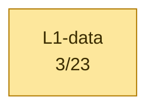

# Calypso test report — 2026-10-17T15:30:56

> Auto-generated by `tests/conftest.py::pytest_sessionfinish`.
> Pasteable directly in a GitHub issue/PR (Mermaid blocks render natively).

## Status global

> [!WARNING]
> ⚠️ **PARTIAL** — 8 échec(s), 3/23 passent

| métrique | valeur | interprétation |
|---|---:|---|
| pct brut       | 13 % | `passed / total` (inclut xfail+skip — minore) |
| **pct fonctionnel** | **27 %** | `passed / (passed+failed)` — vrai taux des tests qui prétendent valider |
| pct actionnable | 48 % | `(passed+failed) / total` — non-xfailed/non-skipped |

| résultat | nombre |
|---|---:|
| ✅ passed | 3 |
| ❌ failed | 8 |
| ⏭️ skipped | 12 |
| ⚠️ xfailed | 0 |
| **total** | **23** |


## Variables d'environnement du run

Toutes les variables Calypso/pipeline manipulées par `run.sh` (extraites du
script + os.environ). `env` = passée explicitement au lancement ; `default` =
valeur fallback de `run.sh`.

| Variable | Valeur | Source |
|---|---|---|
| `CALYPSO_TEST_OUT` | `/opt/GSM/tests/pytest/couche1` | env |


## Pipeline — où ça casse

Le pipeline ci-dessous trace le flux logique GSM Calypso, étape par étape.
Chaque étape est colorée selon le ratio de tests qui passent. **Si une étape
est rouge (0% pass), c'est le premier blocker** — tout ce qui vient après
ne peut pas être validé tant qu'elle n'est pas verte.




## Blockers

**8 test(s) en échec** :

🔴 **1. `test_backend_grgsm_annonce`** — Banc / L1-data — marker(s): banc_couche1,grgsm — durée 0.00s
  - `test_20_couche1_grgsm.py::test_backend_grgsm_annonce`
  - ❗ `test_20_couche1_grgsm.py:19: in test_backend_grgsm_annonce`
🔻 **2. `test_canal_dedie_sdcch`** — Banc / L1-data — marker(s): banc_couche1,grgsm — durée 0.00s
  - `test_20_couche1_grgsm.py::test_canal_dedie_sdcch`
  - ❗ `test_20_couche1_grgsm.py:55: in test_canal_dedie_sdcch`
🔻 **3. `test_chiffrement_a5_publie_et_confirme`** — Banc / L1-data — marker(s): banc_couche1,grgsm — durée 0.00s
  - `test_20_couche1_grgsm.py::test_chiffrement_a5_publie_et_confirme`
  - ❗ `test_20_couche1_grgsm.py:60: in test_chiffrement_a5_publie_et_confirme`
🔻 **4. `test_immediate_assignment_vu`** — Banc / L1-data — marker(s): banc_couche1,grgsm — durée 0.00s
  - `test_20_couche1_grgsm.py::test_immediate_assignment_vu`
  - ❗ `test_20_couche1_grgsm.py:50: in test_immediate_assignment_vu`
🔻 **5. `test_pont_rach_monte`** — Banc / L1-data — marker(s): banc_couche1,grgsm — durée 0.00s
  - `test_20_couche1_grgsm.py::test_pont_rach_monte`
  - ❗ `test_20_couche1_grgsm.py:45: in test_pont_rach_monte`
🔻 **6. `test_pont_stats_bursts_descendants`** — Banc / L1-data — marker(s): banc_couche1,grgsm — durée 0.00s
  - `test_20_couche1_grgsm.py::test_pont_stats_bursts_descendants`
  - ❗ `test_20_couche1_grgsm.py:32: in test_pont_stats_bursts_descendants`
🔻 **7. `test_process_couche1`** — Banc / L1-data — marker(s): banc_couche1,grgsm — durée 0.02s
  - `test_20_couche1_grgsm.py::test_process_couche1`
  - ❗ `test_20_couche1_grgsm.py:13: in test_process_couche1`
🔻 **8. `test_synchro_fb_sb`** — Banc / L1-data — marker(s): banc_couche1,grgsm — durée 0.00s
  - `test_20_couche1_grgsm.py::test_synchro_fb_sb`
  - ❗ `test_20_couche1_grgsm.py:25: in test_synchro_fb_sb`

## Couches — ce qui marche, ce qui casse

### 🟡 `L1-data` — 3/23
❌ **Échecs :** `test_process_couche1`, `test_backend_grgsm_annonce`, `test_synchro_fb_sb`, `test_pont_stats_bursts_descendants`, `test_pont_rach_monte`, `test_immediate_assignment_vu`, `test_canal_dedie_sdcch`, `test_chiffrement_a5_publie_et_confirme`
⏭️ **Skipped :** `test_process_couche1`, `test_api_ram_partagee`, `test_tache_fb_postee_et_fb_detecte`, `test_sb_plausible`, `test_rach_publie`, `test_canal_dedie_suivi`, `test_chiffrement_a5_dans_le_dsp`, `test_bascule_tch_suit_le_firmware`, `test_parole_descendante_pas_toute_bfi`, `test_marge_temps_reel`, `test_garde_mvkd_muette`, `test_pas_de_los_en_dedie`


## Diagramme détaillé — un graphe par catégorie

Chaque catégorie est rendue dans un graphe séparé pour lisibilité (un seul
gros graphe avec subgraphs imbriqués devient illisible >50 tests). Les
catégories sont indépendantes côté layout — pas de chaîne causale entre
elles dans le détail (voir le pipeline plus haut pour ça).

### 🟡 `Banc` — 3/23

```mermaid
flowchart TB
  classDef pass    fill:#bef5b1,stroke:#1f7a1f,color:#0a3d0a;
  classDef partial fill:#fde79c,stroke:#b07a00,color:#3a2c00;
  classDef fail    fill:#fbb4b4,stroke:#a31a1a,color:#5a0000;
  classDef skip    fill:#e0e0e0,stroke:#6a6a6a,color:#333;
  classDef xfail   fill:#fde79c,stroke:#b07a00,color:#3a2c00;
  C_Banc["Banc<br/>3/23"]
  C_Banc --> T_001_pass_grp_Banc["PASS 3<br/>0.0s"]
  C_Banc --> T_002_test_process_couche1["test_process_couche1<br/>L1-data - banc_couche1<br/>0.02s"]
  C_Banc --> T_003_test_backend_grgsm_annonce["test_backend_grgsm_annonce<br/>L1-data - banc_couche1<br/>0.00s"]
  C_Banc --> T_004_test_synchro_fb_sb["test_synchro_fb_sb<br/>L1-data - banc_couche1<br/>0.00s"]
  C_Banc --> T_005_test_pont_stats_bursts_descendants["test_pont_stats_bursts_descendants<br/>L1-data - banc_couche1<br/>0.00s"]
  C_Banc --> T_006_test_pont_rach_monte["test_pont_rach_monte<br/>L1-data - banc_couche1<br/>0.00s"]
  C_Banc --> T_007_test_immediate_assignment_vu["test_immediate_assignment_vu<br/>L1-data - banc_couche1<br/>0.00s"]
  C_Banc --> T_008_test_canal_dedie_sdcch["test_canal_dedie_sdcch<br/>L1-data - banc_couche1<br/>0.00s"]
  C_Banc --> T_009_test_chiffrement_a5_publie_et_confirme["test_chiffrement_a5_publie_et_confirme<br/>L1-data - banc_couche1<br/>0.00s"]
  C_Banc --> T_010_test_process_couche1["test_process_couche1<br/>L1-data - banc_couche1<br/>0.00s"]
  C_Banc --> T_011_test_api_ram_partagee["test_api_ram_partagee<br/>L1-data - banc_couche1<br/>0.00s"]
  C_Banc --> T_012_test_tache_fb_postee_et_fb_detecte["test_tache_fb_postee_et_fb_detecte<br/>L1-data - banc_couche1<br/>0.00s"]
  C_Banc --> T_013_test_sb_plausible["test_sb_plausible<br/>L1-data - banc_couche1<br/>0.00s"]
  C_Banc --> T_014_test_rach_publie["test_rach_publie<br/>L1-data - banc_couche1<br/>0.00s"]
  C_Banc --> T_015_test_canal_dedie_suivi["test_canal_dedie_suivi<br/>L1-data - banc_couche1<br/>0.00s"]
  C_Banc --> T_016_test_chiffrement_a5_dans_le_dsp["test_chiffrement_a5_dans_le_dsp<br/>L1-data - banc_couche1<br/>0.00s"]
  C_Banc --> T_017_test_bascule_tch_suit_le_firmware["test_bascule_tch_suit_le_firmware<br/>L1-data - banc_couche1<br/>0.00s"]
  C_Banc --> T_018_test_parole_descendante_pas_toute_bfi["test_parole_descendante_pas_toute_bfi<br/>L1-data - banc_couche1<br/>0.00s"]
  C_Banc --> T_019_test_marge_temps_reel["test_marge_temps_reel<br/>L1-data - banc_couche1<br/>0.00s"]
  C_Banc --> T_020_test_garde_mvkd_muette["test_garde_mvkd_muette<br/>L1-data - banc_couche1<br/>0.00s"]
  C_Banc --> T_021_test_pas_de_los_en_dedie["test_pas_de_los_en_dedie<br/>L1-data - banc_couche1<br/>0.00s"]
  class C_Banc partial;
  class T_001_pass_grp_Banc pass;
  class T_002_test_process_couche1 fail;
  class T_003_test_backend_grgsm_annonce fail;
  class T_004_test_synchro_fb_sb fail;
  class T_005_test_pont_stats_bursts_descendants fail;
  class T_006_test_pont_rach_monte fail;
  class T_007_test_immediate_assignment_vu fail;
  class T_008_test_canal_dedie_sdcch fail;
  class T_009_test_chiffrement_a5_publie_et_confirme fail;
  class T_010_test_process_couche1 skip;
  class T_011_test_api_ram_partagee skip;
  class T_012_test_tache_fb_postee_et_fb_detecte skip;
  class T_013_test_sb_plausible skip;
  class T_014_test_rach_publie skip;
  class T_015_test_canal_dedie_suivi skip;
  class T_016_test_chiffrement_a5_dans_le_dsp skip;
  class T_017_test_bascule_tch_suit_le_firmware skip;
  class T_018_test_parole_descendante_pas_toute_bfi skip;
  class T_019_test_marge_temps_reel skip;
  class T_020_test_garde_mvkd_muette skip;
  class T_021_test_pas_de_los_en_dedie skip;
```




## Skipped / xfailed

### 12 skipped
- `test_process_couche1` — banc_couche1,dsp,skip
- `test_api_ram_partagee` — banc_couche1,dsp,skip
- `test_tache_fb_postee_et_fb_detecte` — banc_couche1,dsp,skip
- `test_sb_plausible` — banc_couche1,dsp,skip
- `test_rach_publie` — banc_couche1,dsp,skip
- `test_canal_dedie_suivi` — banc_couche1,dsp,skip
- `test_chiffrement_a5_dans_le_dsp` — banc_couche1,dsp,skip
- `test_bascule_tch_suit_le_firmware` — banc_couche1,dsp,skip
- `test_parole_descendante_pas_toute_bfi` — banc_couche1,dsp,skip
- `test_marge_temps_reel` — banc_couche1,dsp,skip
- `test_garde_mvkd_muette` — banc_couche1,dsp,skip
- `test_pas_de_los_en_dedie` — banc_couche1,dsp,skip

## Catalogue des tests

Liste exhaustive des tests exécutés ce run, groupés par marker pytest.
Source : nodeids pytest + outcome. Pour chaque test, le statut, la durée
et le fichier source.

### `banc_couche1` — 3/23

| Status | Test | Durée | Fichier |
|---|---|---:|---|
| ❌ failed | `test_backend_grgsm_annonce` | 0.00s | `test_20_couche1_grgsm.py` |
| ❌ failed | `test_canal_dedie_sdcch` | 0.00s | `test_20_couche1_grgsm.py` |
| ❌ failed | `test_chiffrement_a5_publie_et_confirme` | 0.00s | `test_20_couche1_grgsm.py` |
| ❌ failed | `test_immediate_assignment_vu` | 0.00s | `test_20_couche1_grgsm.py` |
| ❌ failed | `test_pont_rach_monte` | 0.00s | `test_20_couche1_grgsm.py` |
| ❌ failed | `test_pont_stats_bursts_descendants` | 0.00s | `test_20_couche1_grgsm.py` |
| ❌ failed | `test_process_couche1` | 0.02s | `test_20_couche1_grgsm.py` |
| ❌ failed | `test_synchro_fb_sb` | 0.00s | `test_20_couche1_grgsm.py` |
| ✅ passed | `test_pas_de_release_orphelin` | 0.00s | `test_20_couche1_grgsm.py` |
| ✅ passed | `test_pas_de_saut_de_frequence_non_gere` | 0.00s | `test_20_couche1_grgsm.py` |
| ✅ passed | `test_qemu_sans_crash` | 0.00s | `test_20_couche1_grgsm.py` |
| ⏭️ skipped | `test_api_ram_partagee` | 0.00s | `test_21_couche1_dsp.py` |
| ⏭️ skipped | `test_bascule_tch_suit_le_firmware` | 0.00s | `test_21_couche1_dsp.py` |
| ⏭️ skipped | `test_canal_dedie_suivi` | 0.00s | `test_21_couche1_dsp.py` |
| ⏭️ skipped | `test_chiffrement_a5_dans_le_dsp` | 0.00s | `test_21_couche1_dsp.py` |
| ⏭️ skipped | `test_garde_mvkd_muette` | 0.00s | `test_21_couche1_dsp.py` |
| ⏭️ skipped | `test_marge_temps_reel` | 0.00s | `test_21_couche1_dsp.py` |
| ⏭️ skipped | `test_parole_descendante_pas_toute_bfi` | 0.00s | `test_21_couche1_dsp.py` |
| ⏭️ skipped | `test_pas_de_los_en_dedie` | 0.00s | `test_21_couche1_dsp.py` |
| ⏭️ skipped | `test_process_couche1` | 0.00s | `test_21_couche1_dsp.py` |
| ⏭️ skipped | `test_rach_publie` | 0.00s | `test_21_couche1_dsp.py` |
| ⏭️ skipped | `test_sb_plausible` | 0.00s | `test_21_couche1_dsp.py` |
| ⏭️ skipped | `test_tache_fb_postee_et_fb_detecte` | 0.00s | `test_21_couche1_dsp.py` |

### `dsp` — 0/12

| Status | Test | Durée | Fichier |
|---|---|---:|---|
| ⏭️ skipped | `test_api_ram_partagee` | 0.00s | `test_21_couche1_dsp.py` |
| ⏭️ skipped | `test_bascule_tch_suit_le_firmware` | 0.00s | `test_21_couche1_dsp.py` |
| ⏭️ skipped | `test_canal_dedie_suivi` | 0.00s | `test_21_couche1_dsp.py` |
| ⏭️ skipped | `test_chiffrement_a5_dans_le_dsp` | 0.00s | `test_21_couche1_dsp.py` |
| ⏭️ skipped | `test_garde_mvkd_muette` | 0.00s | `test_21_couche1_dsp.py` |
| ⏭️ skipped | `test_marge_temps_reel` | 0.00s | `test_21_couche1_dsp.py` |
| ⏭️ skipped | `test_parole_descendante_pas_toute_bfi` | 0.00s | `test_21_couche1_dsp.py` |
| ⏭️ skipped | `test_pas_de_los_en_dedie` | 0.00s | `test_21_couche1_dsp.py` |
| ⏭️ skipped | `test_process_couche1` | 0.00s | `test_21_couche1_dsp.py` |
| ⏭️ skipped | `test_rach_publie` | 0.00s | `test_21_couche1_dsp.py` |
| ⏭️ skipped | `test_sb_plausible` | 0.00s | `test_21_couche1_dsp.py` |
| ⏭️ skipped | `test_tache_fb_postee_et_fb_detecte` | 0.00s | `test_21_couche1_dsp.py` |

### `grgsm` — 3/11

| Status | Test | Durée | Fichier |
|---|---|---:|---|
| ❌ failed | `test_backend_grgsm_annonce` | 0.00s | `test_20_couche1_grgsm.py` |
| ❌ failed | `test_canal_dedie_sdcch` | 0.00s | `test_20_couche1_grgsm.py` |
| ❌ failed | `test_chiffrement_a5_publie_et_confirme` | 0.00s | `test_20_couche1_grgsm.py` |
| ❌ failed | `test_immediate_assignment_vu` | 0.00s | `test_20_couche1_grgsm.py` |
| ❌ failed | `test_pont_rach_monte` | 0.00s | `test_20_couche1_grgsm.py` |
| ❌ failed | `test_pont_stats_bursts_descendants` | 0.00s | `test_20_couche1_grgsm.py` |
| ❌ failed | `test_process_couche1` | 0.02s | `test_20_couche1_grgsm.py` |
| ❌ failed | `test_synchro_fb_sb` | 0.00s | `test_20_couche1_grgsm.py` |
| ✅ passed | `test_pas_de_release_orphelin` | 0.00s | `test_20_couche1_grgsm.py` |
| ✅ passed | `test_pas_de_saut_de_frequence_non_gere` | 0.00s | `test_20_couche1_grgsm.py` |
| ✅ passed | `test_qemu_sans_crash` | 0.00s | `test_20_couche1_grgsm.py` |

### `skip` — 0/12

| Status | Test | Durée | Fichier |
|---|---|---:|---|
| ⏭️ skipped | `test_api_ram_partagee` | 0.00s | `test_21_couche1_dsp.py` |
| ⏭️ skipped | `test_bascule_tch_suit_le_firmware` | 0.00s | `test_21_couche1_dsp.py` |
| ⏭️ skipped | `test_canal_dedie_suivi` | 0.00s | `test_21_couche1_dsp.py` |
| ⏭️ skipped | `test_chiffrement_a5_dans_le_dsp` | 0.00s | `test_21_couche1_dsp.py` |
| ⏭️ skipped | `test_garde_mvkd_muette` | 0.00s | `test_21_couche1_dsp.py` |
| ⏭️ skipped | `test_marge_temps_reel` | 0.00s | `test_21_couche1_dsp.py` |
| ⏭️ skipped | `test_parole_descendante_pas_toute_bfi` | 0.00s | `test_21_couche1_dsp.py` |
| ⏭️ skipped | `test_pas_de_los_en_dedie` | 0.00s | `test_21_couche1_dsp.py` |
| ⏭️ skipped | `test_process_couche1` | 0.00s | `test_21_couche1_dsp.py` |
| ⏭️ skipped | `test_rach_publie` | 0.00s | `test_21_couche1_dsp.py` |
| ⏭️ skipped | `test_sb_plausible` | 0.00s | `test_21_couche1_dsp.py` |
| ⏭️ skipped | `test_tache_fb_postee_et_fb_detecte` | 0.00s | `test_21_couche1_dsp.py` |


## Cadence des logs et timers dans le temps

Compte des événements par bucket 10s wall, généré par
`log_timeline.py` sur les logs préfixés `<epoch_sec> +<rel_sec>s` par
`run.sh`. Source : `log_timeline.csv` dans ce dossier. Le plot est produit
côté RStudio/Quarto via le chunk R ci-dessous (no-op en markdown GitHub —
ouvrir le `.qmd` dans RStudio ou lancer `quarto render` pour le rendu).

```{r log-timeline, fig.cap="Cadence logs (sources) + timers (dé-thinned vs nominal GSM)", fig.width=12, fig.height=9, echo=FALSE, message=FALSE, warning=FALSE}
if (!requireNamespace("ggplot2", quietly=TRUE) ||
    !requireNamespace("tidyr",  quietly=TRUE) ||
    !file.exists("log_timeline.csv")) {
  message("ggplot2/tidyr absent OU log_timeline.csv absent dans le dossier de rendu — plot timeline saute (pas d'erreur)")
} else {
  library(ggplot2); library(tidyr)
  df <- read.csv("log_timeline.csv")

  # Plot 1 — log volume per source (events/s)
  src_cols <- c("qemu", "bridge", "osmocon", "mobile")
  p1_data <- pivot_longer(df[, c("t_rel", src_cols)], cols=-t_rel,
                          names_to="source", values_to="events")
  p1_data$rate <- p1_data$events / 10
  p1 <- ggplot(p1_data, aes(t_rel, rate, color=source)) +
    geom_line(linewidth=0.6) + scale_y_log10() +
    labs(title="Cadence brute des logs (events/s)",
         x="t_rel (s)", y="events / s (log scale)") +
    theme_minimal()

  # Plot 2 — timer rates dé-thinned vs nominal GSM
  # tdma & frame_irq loggués 1/1000 ; kick 1/200
  thinning <- c(tdma=1000, frame_irq=1000, kick=200)
  nominal  <- c(tdma=216.7, frame_irq=216.7, kick=200.0)
  tcols <- c("tdma", "frame_irq", "kick")
  p2_data <- pivot_longer(df[, c("t_rel", tcols)], cols=-t_rel,
                          names_to="timer", values_to="events")
  p2_data$rate <- (p2_data$events / 10) *
                  thinning[p2_data$timer]
  nom_df <- data.frame(timer=tcols, nominal=as.numeric(nominal[tcols]))
  p2 <- ggplot(p2_data, aes(t_rel, rate, color=timer)) +
    geom_line(linewidth=0.8) +
    geom_hline(data=nom_df, aes(yintercept=nominal, color=timer),
               linetype="dashed", alpha=0.6) +
    scale_y_log10() +
    labs(title="Timers QEMU : mesurée (lignes) vs nominale (pointillés)",
         subtitle="dé-thinned ×1000 (tdma/frame_irq) ×200 (kick)",
         x="t_rel (s)", y="timer events / s (log scale)") +
    theme_minimal()

  # Plot 3 — DSP signals
  dsp_cols <- c("fb_det_hit", "stack_in_ndb")
  p3_data <- pivot_longer(df[, c("t_rel", dsp_cols)], cols=-t_rel,
                          names_to="signal", values_to="events")
  p3_data$rate <- p3_data$events / 10
  p3 <- ggplot(p3_data, aes(t_rel, rate, color=signal)) +
    geom_line(linewidth=0.6) + scale_y_log10() +
    labs(title="DSP signals (fb-det convergence + stack runaway)",
         x="t_rel (s)", y="events / s (log scale)") +
    theme_minimal()

  # Stack vertical
  if (requireNamespace("patchwork", quietly=TRUE)) {
    library(patchwork); print(p1 / p2 / p3)
  } else {
    print(p1); print(p2); print(p3)
  }
}
```

<details>
<summary>Table brute par bucket 10s — cliquer pour déplier</summary>

```

```

</details>

## Résultats bruts pytest

<details>
<summary>Cliquer pour déplier — sortie verbatim type <code>pytest -v</code></summary>

```
FAILED   test_20_couche1_grgsm.py::test_process_couche1 (0.019s)
FAILED   test_20_couche1_grgsm.py::test_backend_grgsm_annonce (0.000s)
FAILED   test_20_couche1_grgsm.py::test_synchro_fb_sb (0.000s)
FAILED   test_20_couche1_grgsm.py::test_pont_stats_bursts_descendants (0.000s)
FAILED   test_20_couche1_grgsm.py::test_pont_rach_monte (0.000s)
FAILED   test_20_couche1_grgsm.py::test_immediate_assignment_vu (0.000s)
FAILED   test_20_couche1_grgsm.py::test_canal_dedie_sdcch (0.000s)
FAILED   test_20_couche1_grgsm.py::test_chiffrement_a5_publie_et_confirme (0.000s)
PASSED   test_20_couche1_grgsm.py::test_pas_de_saut_de_frequence_non_gere (0.000s)
PASSED   test_20_couche1_grgsm.py::test_pas_de_release_orphelin (0.000s)
PASSED   test_20_couche1_grgsm.py::test_qemu_sans_crash (0.000s)
SKIPPED  test_21_couche1_dsp.py::test_process_couche1 (0.000s)
SKIPPED  test_21_couche1_dsp.py::test_api_ram_partagee (0.000s)
SKIPPED  test_21_couche1_dsp.py::test_tache_fb_postee_et_fb_detecte (0.000s)
SKIPPED  test_21_couche1_dsp.py::test_sb_plausible (0.000s)
SKIPPED  test_21_couche1_dsp.py::test_rach_publie (0.000s)
SKIPPED  test_21_couche1_dsp.py::test_canal_dedie_suivi (0.000s)
SKIPPED  test_21_couche1_dsp.py::test_chiffrement_a5_dans_le_dsp (0.000s)
SKIPPED  test_21_couche1_dsp.py::test_bascule_tch_suit_le_firmware (0.000s)
SKIPPED  test_21_couche1_dsp.py::test_parole_descendante_pas_toute_bfi (0.000s)
SKIPPED  test_21_couche1_dsp.py::test_marge_temps_reel (0.000s)
SKIPPED  test_21_couche1_dsp.py::test_garde_mvkd_muette (0.000s)
SKIPPED  test_21_couche1_dsp.py::test_pas_de_los_en_dedie (0.000s)

============================================================
3 passed, 8 failed, 12 skipped in 0.02s
```

</details>

## Plan IrDA debug channel (Phase 2)

Statut auto-détecté depuis l'état du run.

| Phase | Objectif | Statut | Action / notes |
|---|---|---|---|
| **Phase 0** | Reconnaissance UART_IRDA mapped + fw driver | ✅ done | QEMU `calypso_soc.c:231-247`, fw `compal_e88/init.c:105` |
| **Phase 0.5** | Smoke test cons_puts boot marker | 🔧 à faire | ajouter `cons_puts("=== fw-irda boot OK ===\r\n")` après `cons_bind_uart(UART_IRDA)` |
| **Phase 1** | QEMU side mapping chardev → UART_IRDA | ⏸️ caduc | déjà en place via `-serial pty -serial pty` + `serial_hd(1)` |
| **Phase 2** | Firmware side wrapper IrDA | ⏸️ caduc | déjà en place via driver osmocom-bb existant |
| **Phase 3** | Capture host `irda_capture.py` → `/tmp/fw-irda.log` | 🔧 lancer le script | `python3 tools/irda_capture.py /dev/pts/3 &` (auto-lancé par run.sh à terme) |
| **Phase 4** | Tests integration (`test_irda_channel.py`, marker runtime_irda) | 🔧 | 8 tests gradés selon état (boot/produces/throughput/...) |
| **Phase 5** | Instrumentation fw `cons_puts(UART_IRDA, ...)` dans hot path | 🔧 à faire | diagnostiquer le mur `task=24 → DATA_IND=0` — events `EVT_TASK24_*` |
| **Phase 6** | Plot Quarto stacked area des events fw | 🔧 manuel | extension R chunk dans `log_timeline.csv` parser fw-irda events |

_Détection auto basée sur : `/tmp/fw-irda.log` (absent, 0 bytes), `irda_capture.pid` (non), boot marker (absent)._

Réf. `PLAN_CLAUDE_CODE_20260516_IRDA_DEBUG_CHANNEL.md`.

## Chapitre — Blockers détaillés

Pour chaque test en échec : catégorie, couche, marker, message d'assertion,
audit Python dynamique (greps des keywords du message contre tous les logs
container), et stack trace complet dépliable.

_8 test(s) en échec, triés par ordre pipeline (le premier est l'upstream le plus en amont). Chaque entrée inclut un audit dynamique des keywords du message d'assertion._

### 🛑 1. `test_backend_grgsm_annonce`

- **Catégorie / couche** : Banc / L1-data
- **Marker(s)** : banc_couche1,grgsm
- **Durée** : 0.00s
- **Nodeid** : `test_20_couche1_grgsm.py::test_backend_grgsm_annonce`
- **Assertion** : `test_20_couche1_grgsm.py:19: in test_backend_grgsm_annonce`

<details><summary>Stack trace complet (dépliable)</summary>

```
test_20_couche1_grgsm.py:19: in test_backend_grgsm_annonce
    assert banc.count("qemu", r"backend gr-gsm") >= 1, "qemu.log : la couche 1 gr-gsm ne s'est pas annoncee"
E   AssertionError: qemu.log : la couche 1 gr-gsm ne s'est pas annoncee
E   assert 0 >= 1
E    +  where 0 = <function count at 0x7fdc45623d80>('qemu', 'backend gr-gsm')
E    +    where <function count at 0x7fdc45623d80> = banc.count
```

</details>

### 🛑 2. `test_canal_dedie_sdcch`

- **Catégorie / couche** : Banc / L1-data
- **Marker(s)** : banc_couche1,grgsm
- **Durée** : 0.00s
- **Nodeid** : `test_20_couche1_grgsm.py::test_canal_dedie_sdcch`
- **Assertion** : `test_20_couche1_grgsm.py:55: in test_canal_dedie_sdcch`

<details><summary>Stack trace complet (dépliable)</summary>

```
test_20_couche1_grgsm.py:55: in test_canal_dedie_sdcch
    assert banc.count("qemu", r"canal dedie SDCCH") >= 1, "aucun canal dedie SDCCH ouvert cote QEMU"
E   AssertionError: aucun canal dedie SDCCH ouvert cote QEMU
E   assert 0 >= 1
E    +  where 0 = <function count at 0x7fdc45623d80>('qemu', 'canal dedie SDCCH')
E    +    where <function count at 0x7fdc45623d80> = banc.count
```

</details>

### 🛑 3. `test_chiffrement_a5_publie_et_confirme`

- **Catégorie / couche** : Banc / L1-data
- **Marker(s)** : banc_couche1,grgsm
- **Durée** : 0.00s
- **Nodeid** : `test_20_couche1_grgsm.py::test_chiffrement_a5_publie_et_confirme`
- **Assertion** : `test_20_couche1_grgsm.py:60: in test_chiffrement_a5_publie_et_confirme`

<details><summary>Stack trace complet (dépliable)</summary>

```
test_20_couche1_grgsm.py:60: in test_chiffrement_a5_publie_et_confirme
    assert banc.count("qemu", r"chiffrement A5/") >= 1, "Kc jamais publie par le firmware"
E   AssertionError: Kc jamais publie par le firmware
E   assert 0 >= 1
E    +  where 0 = <function count at 0x7fdc45623d80>('qemu', 'chiffrement A5/')
E    +    where <function count at 0x7fdc45623d80> = banc.count
```

</details>

### 🛑 4. `test_immediate_assignment_vu`

- **Catégorie / couche** : Banc / L1-data
- **Marker(s)** : banc_couche1,grgsm
- **Durée** : 0.00s
- **Nodeid** : `test_20_couche1_grgsm.py::test_immediate_assignment_vu`
- **Assertion** : `test_20_couche1_grgsm.py:50: in test_immediate_assignment_vu`

<details><summary>Stack trace complet (dépliable)</summary>

```
test_20_couche1_grgsm.py:50: in test_immediate_assignment_vu
    assert banc.count("pont", r"IMMEDIATE ASSIGNMENT") >= 1
E   AssertionError: assert 0 >= 1
E    +  where 0 = <function count at 0x7fdc45623d80>('pont', 'IMMEDIATE ASSIGNMENT')
E    +    where <function count at 0x7fdc45623d80> = banc.count
```

</details>

### 🛑 5. `test_pont_rach_monte`

- **Catégorie / couche** : Banc / L1-data
- **Marker(s)** : banc_couche1,grgsm
- **Durée** : 0.00s
- **Nodeid** : `test_20_couche1_grgsm.py::test_pont_rach_monte`
- **Assertion** : `test_20_couche1_grgsm.py:45: in test_pont_rach_monte`

<details><summary>Stack trace complet (dépliable)</summary>

```
test_20_couche1_grgsm.py:45: in test_pont_rach_monte
    assert m and int(m.group(1)) >= 1, f"aucun RACH publie par le firmware : {ln}"
E   AssertionError: aucun RACH publie par le firmware : 
E   assert (None)
```

</details>

### 🛑 6. `test_pont_stats_bursts_descendants`

- **Catégorie / couche** : Banc / L1-data
- **Marker(s)** : banc_couche1,grgsm
- **Durée** : 0.00s
- **Nodeid** : `test_20_couche1_grgsm.py::test_pont_stats_bursts_descendants`
- **Assertion** : `test_20_couche1_grgsm.py:32: in test_pont_stats_bursts_descendants`

<details><summary>Stack trace complet (dépliable)</summary>

```
test_20_couche1_grgsm.py:32: in test_pont_stats_bursts_descendants
    assert ln, "pont.log sans ligne STATS"
E   AssertionError: pont.log sans ligne STATS
E   assert ''
```

</details>

### 🛑 7. `test_process_couche1`

- **Catégorie / couche** : Banc / L1-data
- **Marker(s)** : banc_couche1,grgsm
- **Durée** : 0.02s
- **Nodeid** : `test_20_couche1_grgsm.py::test_process_couche1`
- **Assertion** : `test_20_couche1_grgsm.py:13: in test_process_couche1`

<details><summary>Stack trace complet (dépliable)</summary>

```
test_20_couche1_grgsm.py:13: in test_process_couche1
    assert banc.alive("qemu-system-arm"), "qemu-system-arm absent"
E   AssertionError: qemu-system-arm absent
E   assert False
E    +  where False = <function alive at 0x7fdc45623a60>('qemu-system-arm')
E    +    where <function alive at 0x7fdc45623a60> = banc.alive
```

</details>

### 🛑 8. `test_synchro_fb_sb`

- **Catégorie / couche** : Banc / L1-data
- **Marker(s)** : banc_couche1,grgsm
- **Durée** : 0.00s
- **Nodeid** : `test_20_couche1_grgsm.py::test_synchro_fb_sb`
- **Assertion** : `test_20_couche1_grgsm.py:25: in test_synchro_fb_sb`

<details><summary>Stack trace complet (dépliable)</summary>

```
test_20_couche1_grgsm.py:25: in test_synchro_fb_sb
    assert ln, "pas de « synchro gr-gsm : ARFCN=... BSIC=... » : FB/SB non decodes"
E   AssertionError: pas de « synchro gr-gsm : ARFCN=... BSIC=... » : FB/SB non decodes
E   assert ''
```

</details>


## Annexe — Audit indépendant (`abstract.py`)

Re-compute peer-level produit par `abstract.py` (script racine du repo) à
partir de `results.json` + `log_timeline.csv` du dossier de run. Ne fait pas
confiance au markdown généré — donne une 2ème lecture indépendante des
mêmes données.

<details markdown="1"><summary>Déplier — audit `abstract.py`</summary>

_`abstract.py` introuvable à la racine du repo._


</details>

## Annexe — Diag snapshot (état runtime au moment des tests)

Snapshot rapide produit par `make_diag.sh` au cours de la session pytest.
Pour un bundle complet (tar.gz avec tous les logs filtrés + dumps DSP), utiliser
`./make_diag_bundle.sh`.

<details markdown="1"><summary>Déplier — diag snapshot</summary>

_diag : `make_diag.sh` introuvable à la racine du repo._


</details>

## Annexe — Bundle make_diag_bundle.sh

Bundle généré pendant la session via `make_diag_bundle.sh` (inventaire + digests
texte embarqués). Les logs bruts (qemu_diag, bridge, osmocon, etc.) sont listés
seulement — récupérer le tar.gz pour les contenus complets.

<details markdown="1"><summary>Déplier — bundle make_diag_bundle.sh</summary>

_`make_diag_bundle.sh` introuvable ; ou poser CALYPSO_DIAG_BUNDLE=<tar.gz>._


</details>

## Annexe — Détail complet de tous les tests

<details markdown="1"><summary>Déplier — table complète de tous les tests</summary>

### Banc / L1-data — 3/23

| | Test | Markers | Durée | Erreur / raison (si non-pass) |
|---|---|---|---:|---|
| ❌ | `test_backend_grgsm_annonce` | banc_couche1,grgsm | 0.00s | test_20_couche1_grgsm.py:19: in test_backend_grgsm_annonce |
| ❌ | `test_canal_dedie_sdcch` | banc_couche1,grgsm | 0.00s | test_20_couche1_grgsm.py:55: in test_canal_dedie_sdcch |
| ❌ | `test_chiffrement_a5_publie_et_confirme` | banc_couche1,grgsm | 0.00s | test_20_couche1_grgsm.py:60: in test_chiffrement_a5_publie_et_confirme |
| ❌ | `test_immediate_assignment_vu` | banc_couche1,grgsm | 0.00s | test_20_couche1_grgsm.py:50: in test_immediate_assignment_vu |
| ❌ | `test_pont_rach_monte` | banc_couche1,grgsm | 0.00s | test_20_couche1_grgsm.py:45: in test_pont_rach_monte |
| ❌ | `test_pont_stats_bursts_descendants` | banc_couche1,grgsm | 0.00s | test_20_couche1_grgsm.py:32: in test_pont_stats_bursts_descendants |
| ❌ | `test_process_couche1` | banc_couche1,grgsm | 0.02s | test_20_couche1_grgsm.py:13: in test_process_couche1 |
| ❌ | `test_synchro_fb_sb` | banc_couche1,grgsm | 0.00s | test_20_couche1_grgsm.py:25: in test_synchro_fb_sb |
| ✅ | `test_pas_de_release_orphelin` | banc_couche1,grgsm | 0.00s |  |
| ✅ | `test_pas_de_saut_de_frequence_non_gere` | banc_couche1,grgsm | 0.00s |  |
| ✅ | `test_qemu_sans_crash` | banc_couche1,grgsm | 0.00s |  |
| ⏭️ | `test_api_ram_partagee` | banc_couche1,dsp,skip | 0.00s | ('/opt/GSM/tests/pytest/test_21_couche1_dsp.py', 19, 'Skipped: test dsp : le banc est en mode grgsm') |
| ⏭️ | `test_bascule_tch_suit_le_firmware` | banc_couche1,dsp,skip | 0.00s | ('/opt/GSM/tests/pytest/test_21_couche1_dsp.py', 53, 'Skipped: test dsp : le banc est en mode grgsm') |
| ⏭️ | `test_canal_dedie_suivi` | banc_couche1,dsp,skip | 0.00s | ('/opt/GSM/tests/pytest/test_21_couche1_dsp.py', 41, 'Skipped: test dsp : le banc est en mode grgsm') |
| ⏭️ | `test_chiffrement_a5_dans_le_dsp` | banc_couche1,dsp,skip | 0.00s | ('/opt/GSM/tests/pytest/test_21_couche1_dsp.py', 47, 'Skipped: test dsp : le banc est en mode grgsm') |
| ⏭️ | `test_garde_mvkd_muette` | banc_couche1,dsp,skip | 0.00s | ('/opt/GSM/tests/pytest/test_21_couche1_dsp.py', 80, 'Skipped: test dsp : le banc est en mode grgsm') |
| ⏭️ | `test_marge_temps_reel` | banc_couche1,dsp,skip | 0.00s | ('/opt/GSM/tests/pytest/test_21_couche1_dsp.py', 71, 'Skipped: test dsp : le banc est en mode grgsm') |
| ⏭️ | `test_parole_descendante_pas_toute_bfi` | banc_couche1,dsp,skip | 0.00s | ('/opt/GSM/tests/pytest/test_21_couche1_dsp.py', 60, 'Skipped: test dsp : le banc est en mode grgsm') |
| ⏭️ | `test_pas_de_los_en_dedie` | banc_couche1,dsp,skip | 0.00s | ('/opt/GSM/tests/pytest/test_21_couche1_dsp.py', 85, 'Skipped: test dsp : le banc est en mode grgsm') |
| ⏭️ | `test_process_couche1` | banc_couche1,dsp,skip | 0.00s | ('/opt/GSM/tests/pytest/test_21_couche1_dsp.py', 13, 'Skipped: test dsp : le banc est en mode grgsm') |
| ⏭️ | `test_rach_publie` | banc_couche1,dsp,skip | 0.00s | ('/opt/GSM/tests/pytest/test_21_couche1_dsp.py', 36, 'Skipped: test dsp : le banc est en mode grgsm') |
| ⏭️ | `test_sb_plausible` | banc_couche1,dsp,skip | 0.00s | ('/opt/GSM/tests/pytest/test_21_couche1_dsp.py', 30, 'Skipped: test dsp : le banc est en mode grgsm') |
| ⏭️ | `test_tache_fb_postee_et_fb_detecte` | banc_couche1,dsp,skip | 0.00s | ('/opt/GSM/tests/pytest/test_21_couche1_dsp.py', 24, 'Skipped: test dsp : le banc est en mode grgsm') |

### Tous les nodeids (référence)

<details>
<summary>Cliquer pour déplier — liste exhaustive nodeid → outcome</summary>

```
FAILED   test_20_couche1_grgsm.py::test_backend_grgsm_annonce
FAILED   test_20_couche1_grgsm.py::test_canal_dedie_sdcch
FAILED   test_20_couche1_grgsm.py::test_chiffrement_a5_publie_et_confirme
FAILED   test_20_couche1_grgsm.py::test_immediate_assignment_vu
PASSED   test_20_couche1_grgsm.py::test_pas_de_release_orphelin
PASSED   test_20_couche1_grgsm.py::test_pas_de_saut_de_frequence_non_gere
FAILED   test_20_couche1_grgsm.py::test_pont_rach_monte
FAILED   test_20_couche1_grgsm.py::test_pont_stats_bursts_descendants
FAILED   test_20_couche1_grgsm.py::test_process_couche1
PASSED   test_20_couche1_grgsm.py::test_qemu_sans_crash
FAILED   test_20_couche1_grgsm.py::test_synchro_fb_sb
SKIPPED  test_21_couche1_dsp.py::test_api_ram_partagee
SKIPPED  test_21_couche1_dsp.py::test_bascule_tch_suit_le_firmware
SKIPPED  test_21_couche1_dsp.py::test_canal_dedie_suivi
SKIPPED  test_21_couche1_dsp.py::test_chiffrement_a5_dans_le_dsp
SKIPPED  test_21_couche1_dsp.py::test_garde_mvkd_muette
SKIPPED  test_21_couche1_dsp.py::test_marge_temps_reel
SKIPPED  test_21_couche1_dsp.py::test_parole_descendante_pas_toute_bfi
SKIPPED  test_21_couche1_dsp.py::test_pas_de_los_en_dedie
SKIPPED  test_21_couche1_dsp.py::test_process_couche1
SKIPPED  test_21_couche1_dsp.py::test_rach_publie
SKIPPED  test_21_couche1_dsp.py::test_sb_plausible
SKIPPED  test_21_couche1_dsp.py::test_tache_fb_postee_et_fb_detecte
```

</details>

</details>

## Reproduction

```bash
cd /home/nirvana/qemu-calypso/tests
/tmp/calypso-venv/bin/pytest -v --tb=short
# Filtrer par marker :
/tmp/calypso-venv/bin/pytest -v -m inject_frames
/tmp/calypso-venv/bin/pytest -v -m 'not inject_efficacy'
```

Le diagramme et ce rapport sont régénérés à chaque run et écrits dans
`/opt/GSM/tests/pytest/couche1/test_results_20261017_153055/test_results.{mmd,md}` (override via `CALYPSO_TEST_OUT`).

---

_Run finished at 2026-10-17T15:30:56._


## Annexe — Report condensé (machine-friendly)

<details markdown="1"><summary>Déplier — report condensé</summary>

> _Rapport condensé (machine-friendly) extrait de `test_results.md`. Pour la version complète : voir le `.md` ou `.qmd` à côté._

## Calypso test report — 2026-10-17T15:30:56

> Auto-generated by `tests/conftest.py::pytest_sessionfinish`.
> Pasteable directly in a GitHub issue/PR (Mermaid blocks render natively).

### Status global

> [!WARNING]
> ⚠️ **PARTIAL** — 8 échec(s), 3/23 passent

| métrique | valeur | interprétation |
|---|---:|---|
| pct brut       | 13 % | `passed / total` (inclut xfail+skip — minore) |
| **pct fonctionnel** | **27 %** | `passed / (passed+failed)` — vrai taux des tests qui prétendent valider |
| pct actionnable | 48 % | `(passed+failed) / total` — non-xfailed/non-skipped |

| résultat | nombre |
|---|---:|
| ✅ passed | 3 |
| ❌ failed | 8 |
| ⏭️ skipped | 12 |
| ⚠️ xfailed | 0 |
| **total** | **23** |


### Variables d'environnement du run

Toutes les variables Calypso/pipeline manipulées par `run.sh` (extraites du
script + os.environ). `env` = passée explicitement au lancement ; `default` =
valeur fallback de `run.sh`.

| Variable | Valeur | Source |
|---|---|---|
| `CALYPSO_TEST_OUT` | `/opt/GSM/tests/pytest/couche1` | env |


### Pipeline — où ça casse

Le pipeline ci-dessous trace le flux logique GSM Calypso, étape par étape.
Chaque étape est colorée selon le ratio de tests qui passent. **Si une étape
est rouge (0% pass), c'est le premier blocker** — tout ce qui vient après
ne peut pas être validé tant qu'elle n'est pas verte.


### Blockers

**8 test(s) en échec** :

🔴 **1. `test_backend_grgsm_annonce`** — Banc / L1-data — marker(s): banc_couche1,grgsm — durée 0.00s
  - `test_20_couche1_grgsm.py::test_backend_grgsm_annonce`
  - ❗ `test_20_couche1_grgsm.py:19: in test_backend_grgsm_annonce`
🔻 **2. `test_canal_dedie_sdcch`** — Banc / L1-data — marker(s): banc_couche1,grgsm — durée 0.00s
  - `test_20_couche1_grgsm.py::test_canal_dedie_sdcch`
  - ❗ `test_20_couche1_grgsm.py:55: in test_canal_dedie_sdcch`
🔻 **3. `test_chiffrement_a5_publie_et_confirme`** — Banc / L1-data — marker(s): banc_couche1,grgsm — durée 0.00s
  - `test_20_couche1_grgsm.py::test_chiffrement_a5_publie_et_confirme`
  - ❗ `test_20_couche1_grgsm.py:60: in test_chiffrement_a5_publie_et_confirme`
🔻 **4. `test_immediate_assignment_vu`** — Banc / L1-data — marker(s): banc_couche1,grgsm — durée 0.00s
  - `test_20_couche1_grgsm.py::test_immediate_assignment_vu`
  - ❗ `test_20_couche1_grgsm.py:50: in test_immediate_assignment_vu`
🔻 **5. `test_pont_rach_monte`** — Banc / L1-data — marker(s): banc_couche1,grgsm — durée 0.00s
  - `test_20_couche1_grgsm.py::test_pont_rach_monte`
  - ❗ `test_20_couche1_grgsm.py:45: in test_pont_rach_monte`
🔻 **6. `test_pont_stats_bursts_descendants`** — Banc / L1-data — marker(s): banc_couche1,grgsm — durée 0.00s
  - `test_20_couche1_grgsm.py::test_pont_stats_bursts_descendants`
  - ❗ `test_20_couche1_grgsm.py:32: in test_pont_stats_bursts_descendants`
🔻 **7. `test_process_couche1`** — Banc / L1-data — marker(s): banc_couche1,grgsm — durée 0.02s
  - `test_20_couche1_grgsm.py::test_process_couche1`
  - ❗ `test_20_couche1_grgsm.py:13: in test_process_couche1`
🔻 **8. `test_synchro_fb_sb`** — Banc / L1-data — marker(s): banc_couche1,grgsm — durée 0.00s
  - `test_20_couche1_grgsm.py::test_synchro_fb_sb`
  - ❗ `test_20_couche1_grgsm.py:25: in test_synchro_fb_sb`

### Couches — ce qui marche, ce qui casse

#### 🟡 `L1-data` — 3/23
❌ **Échecs :** `test_process_couche1`, `test_backend_grgsm_annonce`, `test_synchro_fb_sb`, `test_pont_stats_bursts_descendants`, `test_pont_rach_monte`, `test_immediate_assignment_vu`, `test_canal_dedie_sdcch`, `test_chiffrement_a5_publie_et_confirme`
⏭️ **Skipped :** `test_process_couche1`, `test_api_ram_partagee`, `test_tache_fb_postee_et_fb_detecte`, `test_sb_plausible`, `test_rach_publie`, `test_canal_dedie_suivi`, `test_chiffrement_a5_dans_le_dsp`, `test_bascule_tch_suit_le_firmware`, `test_parole_descendante_pas_toute_bfi`, `test_marge_temps_reel`, `test_garde_mvkd_muette`, `test_pas_de_los_en_dedie`


### Plan IrDA debug channel (Phase 2)

Statut auto-détecté depuis l'état du run.

| Phase | Objectif | Statut | Action / notes |
|---|---|---|---|
| **Phase 0** | Reconnaissance UART_IRDA mapped + fw driver | ✅ done | QEMU `calypso_soc.c:231-247`, fw `compal_e88/init.c:105` |
| **Phase 0.5** | Smoke test cons_puts boot marker | 🔧 à faire | ajouter `cons_puts("=== fw-irda boot OK ===\r\n")` après `cons_bind_uart(UART_IRDA)` |
| **Phase 1** | QEMU side mapping chardev → UART_IRDA | ⏸️ caduc | déjà en place via `-serial pty -serial pty` + `serial_hd(1)` |
| **Phase 2** | Firmware side wrapper IrDA | ⏸️ caduc | déjà en place via driver osmocom-bb existant |
| **Phase 3** | Capture host `irda_capture.py` → `/tmp/fw-irda.log` | 🔧 lancer le script | `python3 tools/irda_capture.py /dev/pts/3 &` (auto-lancé par run.sh à terme) |
| **Phase 4** | Tests integration (`test_irda_channel.py`, marker runtime_irda) | 🔧 | 8 tests gradés selon état (boot/produces/throughput/...) |
| **Phase 5** | Instrumentation fw `cons_puts(UART_IRDA, ...)` dans hot path | 🔧 à faire | diagnostiquer le mur `task=24 → DATA_IND=0` — events `EVT_TASK24_*` |
| **Phase 6** | Plot Quarto stacked area des events fw | 🔧 manuel | extension R chunk dans `log_timeline.csv` parser fw-irda events |

_Détection auto basée sur : `/tmp/fw-irda.log` (absent, 0 bytes), `irda_capture.pid` (non), boot marker (absent)._

Réf. `PLAN_CLAUDE_CODE_20260516_IRDA_DEBUG_CHANNEL.md`.

### Chapitre — Blockers détaillés

Pour chaque test en échec : catégorie, couche, marker, message d'assertion,
audit Python dynamique (greps des keywords du message contre tous les logs
container), et stack trace complet dépliable.

_8 test(s) en échec, triés par ordre pipeline (le premier est l'upstream le plus en amont). Chaque entrée inclut un audit dynamique des keywords du message d'assertion._

#### 🛑 1. `test_backend_grgsm_annonce`

- **Catégorie / couche** : Banc / L1-data
- **Marker(s)** : banc_couche1,grgsm
- **Durée** : 0.00s
- **Nodeid** : `test_20_couche1_grgsm.py::test_backend_grgsm_annonce`
- **Assertion** : `test_20_couche1_grgsm.py:19: in test_backend_grgsm_annonce`


#### 🛑 2. `test_canal_dedie_sdcch`

- **Catégorie / couche** : Banc / L1-data
- **Marker(s)** : banc_couche1,grgsm
- **Durée** : 0.00s
- **Nodeid** : `test_20_couche1_grgsm.py::test_canal_dedie_sdcch`
- **Assertion** : `test_20_couche1_grgsm.py:55: in test_canal_dedie_sdcch`


#### 🛑 3. `test_chiffrement_a5_publie_et_confirme`

- **Catégorie / couche** : Banc / L1-data
- **Marker(s)** : banc_couche1,grgsm
- **Durée** : 0.00s
- **Nodeid** : `test_20_couche1_grgsm.py::test_chiffrement_a5_publie_et_confirme`
- **Assertion** : `test_20_couche1_grgsm.py:60: in test_chiffrement_a5_publie_et_confirme`


#### 🛑 4. `test_immediate_assignment_vu`

- **Catégorie / couche** : Banc / L1-data
- **Marker(s)** : banc_couche1,grgsm
- **Durée** : 0.00s
- **Nodeid** : `test_20_couche1_grgsm.py::test_immediate_assignment_vu`
- **Assertion** : `test_20_couche1_grgsm.py:50: in test_immediate_assignment_vu`


#### 🛑 5. `test_pont_rach_monte`

- **Catégorie / couche** : Banc / L1-data
- **Marker(s)** : banc_couche1,grgsm
- **Durée** : 0.00s
- **Nodeid** : `test_20_couche1_grgsm.py::test_pont_rach_monte`
- **Assertion** : `test_20_couche1_grgsm.py:45: in test_pont_rach_monte`


#### 🛑 6. `test_pont_stats_bursts_descendants`

- **Catégorie / couche** : Banc / L1-data
- **Marker(s)** : banc_couche1,grgsm
- **Durée** : 0.00s
- **Nodeid** : `test_20_couche1_grgsm.py::test_pont_stats_bursts_descendants`
- **Assertion** : `test_20_couche1_grgsm.py:32: in test_pont_stats_bursts_descendants`


#### 🛑 7. `test_process_couche1`

- **Catégorie / couche** : Banc / L1-data
- **Marker(s)** : banc_couche1,grgsm
- **Durée** : 0.02s
- **Nodeid** : `test_20_couche1_grgsm.py::test_process_couche1`
- **Assertion** : `test_20_couche1_grgsm.py:13: in test_process_couche1`


#### 🛑 8. `test_synchro_fb_sb`

- **Catégorie / couche** : Banc / L1-data
- **Marker(s)** : banc_couche1,grgsm
- **Durée** : 0.00s
- **Nodeid** : `test_20_couche1_grgsm.py::test_synchro_fb_sb`
- **Assertion** : `test_20_couche1_grgsm.py:25: in test_synchro_fb_sb`


### Annexe — Audit indépendant (`abstract.py`)

Re-compute peer-level produit par `abstract.py` (script racine du repo) à
partir de `results.json` + `log_timeline.csv` du dossier de run. Ne fait pas
confiance au markdown généré — donne une 2ème lecture indépendante des
mêmes données.


### Annexe — Diag snapshot (état runtime au moment des tests)

Snapshot rapide produit par `make_diag.sh` au cours de la session pytest.
Pour un bundle complet (tar.gz avec tous les logs filtrés + dumps DSP), utiliser
`./make_diag_bundle.sh`.


</details>
