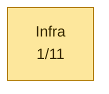

# Calypso test report — 2026-10-17T15:30:54

> Auto-generated by `tests/conftest.py::pytest_sessionfinish`.
> Pasteable directly in a GitHub issue/PR (Mermaid blocks render natively).

## Status global

> [!WARNING]
> ⚠️ **PARTIAL** — 10 échec(s), 1/11 passent

| métrique | valeur | interprétation |
|---|---:|---|
| pct brut       | 9 % | `passed / total` (inclut xfail+skip — minore) |
| **pct fonctionnel** | **9 %** | `passed / (passed+failed)` — vrai taux des tests qui prétendent valider |
| pct actionnable | 100 % | `(passed+failed) / total` — non-xfailed/non-skipped |

| résultat | nombre |
|---|---:|
| ✅ passed | 1 |
| ❌ failed | 10 |
| ⏭️ skipped | 0 |
| ⚠️ xfailed | 0 |
| **total** | **11** |


## Variables d'environnement du run

Toutes les variables Calypso/pipeline manipulées par `run.sh` (extraites du
script + os.environ). `env` = passée explicitement au lancement ; `default` =
valeur fallback de `run.sh`.

| Variable | Valeur | Source |
|---|---|---|
| `CALYPSO_TEST_OUT` | `/opt/GSM/tests/pytest/infra` | env |


## Pipeline — où ça casse

Le pipeline ci-dessous trace le flux logique GSM Calypso, étape par étape.
Chaque étape est colorée selon le ratio de tests qui passent. **Si une étape
est rouge (0% pass), c'est le premier blocker** — tout ce qui vient après
ne peut pas être validé tant qu'elle n'est pas verte.




## Blockers

**10 test(s) en échec** :

🔴 **1. `test_asterisk_sip_5060`** — Banc / Infra — marker(s): banc_infra,commun — durée 0.02s
  - `test_10_infra.py::test_asterisk_sip_5060`
  - ❗ `test_10_infra.py:30: in test_asterisk_sip_5060`
🔻 **2. `test_bts_trx_operationnel`** — Banc / Infra — marker(s): banc_infra,commun — durée 0.00s
  - `test_10_infra.py::test_bts_trx_operationnel`
  - ❗ `test_10_infra.py:25: in test_bts_trx_operationnel`
🔻 **3. `test_bts_trx_vty`** — Banc / Infra — marker(s): banc_infra,commun — durée 0.02s
  - `test_10_infra.py::test_bts_trx_vty`
  - ❗ `test_10_infra.py:19: in test_bts_trx_vty`
🔻 **4. `test_coeur_process_et_vty[osmo-bsc-4242]`** — Banc / Infra — marker(s): banc_infra,commun,parametrize — durée 0.02s
  - `test_10_infra.py::test_coeur_process_et_vty[osmo-bsc-4242]`
  - ❗ `test_10_infra.py:14: in test_coeur_process_et_vty`
🔻 **5. `test_coeur_process_et_vty[osmo-hlr-4258]`** — Banc / Infra — marker(s): banc_infra,commun,parametrize — durée 0.01s
  - `test_10_infra.py::test_coeur_process_et_vty[osmo-hlr-4258]`
  - ❗ `test_10_infra.py:14: in test_coeur_process_et_vty`
🔻 **6. `test_coeur_process_et_vty[osmo-mgw-4243]`** — Banc / Infra — marker(s): banc_infra,commun,parametrize — durée 0.02s
  - `test_10_infra.py::test_coeur_process_et_vty[osmo-mgw-4243]`
  - ❗ `test_10_infra.py:14: in test_coeur_process_et_vty`
🔻 **7. `test_coeur_process_et_vty[osmo-msc-4254]`** — Banc / Infra — marker(s): banc_infra,commun,parametrize — durée 0.02s
  - `test_10_infra.py::test_coeur_process_et_vty[osmo-msc-4254]`
  - ❗ `test_10_infra.py:14: in test_coeur_process_et_vty`
🔻 **8. `test_coeur_process_et_vty[osmo-stp-4239]`** — Banc / Infra — marker(s): banc_infra,commun,parametrize — durée 0.02s
  - `test_10_infra.py::test_coeur_process_et_vty[osmo-stp-4239]`
  - ❗ `test_10_infra.py:14: in test_coeur_process_et_vty`
🔻 **9. `test_proto_smsc_socket`** — Banc / Infra — marker(s): banc_infra,commun — durée 0.00s
  - `test_10_infra.py::test_proto_smsc_socket`
  - ❗ `test_10_infra.py:43: in test_proto_smsc_socket`
🔻 **10. `test_sip_connector_et_mncc`** — Banc / Infra — marker(s): banc_infra,commun — durée 0.02s
  - `test_10_infra.py::test_sip_connector_et_mncc`
  - ❗ `test_10_infra.py:36: in test_sip_connector_et_mncc`

## Couches — ce qui marche, ce qui casse

### 🟡 `Infra` — 1/11
❌ **Échecs :** `test_coeur_process_et_vty[osmo-hlr-4258]`, `test_coeur_process_et_vty[osmo-stp-4239]`, `test_coeur_process_et_vty[osmo-msc-4254]`, `test_coeur_process_et_vty[osmo-bsc-4242]`, `test_coeur_process_et_vty[osmo-mgw-4243]`, `test_bts_trx_vty`, `test_bts_trx_operationnel`, `test_asterisk_sip_5060`, `test_sip_connector_et_mncc`, `test_proto_smsc_socket`


## Diagramme détaillé — un graphe par catégorie

Chaque catégorie est rendue dans un graphe séparé pour lisibilité (un seul
gros graphe avec subgraphs imbriqués devient illisible >50 tests). Les
catégories sont indépendantes côté layout — pas de chaîne causale entre
elles dans le détail (voir le pipeline plus haut pour ça).

### 🟡 `Banc` — 1/11

```mermaid
flowchart TB
  classDef pass    fill:#bef5b1,stroke:#1f7a1f,color:#0a3d0a;
  classDef partial fill:#fde79c,stroke:#b07a00,color:#3a2c00;
  classDef fail    fill:#fbb4b4,stroke:#a31a1a,color:#5a0000;
  classDef skip    fill:#e0e0e0,stroke:#6a6a6a,color:#333;
  classDef xfail   fill:#fde79c,stroke:#b07a00,color:#3a2c00;
  C_Banc["Banc<br/>1/11"]
  C_Banc --> T_001_pass_grp_Banc["PASS 1<br/>0.0s"]
  C_Banc --> T_002_test_coeur_process_et_vty_osmo_hlr_4258_["test_coeur_process_et_vty(osmo-hlr-425<br/>Infra - banc_infra<br/>0.01s"]
  C_Banc --> T_003_test_coeur_process_et_vty_osmo_stp_4239_["test_coeur_process_et_vty(osmo-stp-423<br/>Infra - banc_infra<br/>0.02s"]
  C_Banc --> T_004_test_coeur_process_et_vty_osmo_msc_4254_["test_coeur_process_et_vty(osmo-msc-425<br/>Infra - banc_infra<br/>0.02s"]
  C_Banc --> T_005_test_coeur_process_et_vty_osmo_bsc_4242_["test_coeur_process_et_vty(osmo-bsc-424<br/>Infra - banc_infra<br/>0.02s"]
  C_Banc --> T_006_test_coeur_process_et_vty_osmo_mgw_4243_["test_coeur_process_et_vty(osmo-mgw-424<br/>Infra - banc_infra<br/>0.02s"]
  C_Banc --> T_007_test_bts_trx_vty["test_bts_trx_vty<br/>Infra - banc_infra<br/>0.02s"]
  C_Banc --> T_008_test_bts_trx_operationnel["test_bts_trx_operationnel<br/>Infra - banc_infra<br/>0.00s"]
  C_Banc --> T_009_test_asterisk_sip_5060["test_asterisk_sip_5060<br/>Infra - banc_infra<br/>0.02s"]
  C_Banc --> T_010_test_sip_connector_et_mncc["test_sip_connector_et_mncc<br/>Infra - banc_infra<br/>0.02s"]
  C_Banc --> T_011_test_proto_smsc_socket["test_proto_smsc_socket<br/>Infra - banc_infra<br/>0.00s"]
  class C_Banc partial;
  class T_001_pass_grp_Banc pass;
  class T_002_test_coeur_process_et_vty_osmo_hlr_4258_ fail;
  class T_003_test_coeur_process_et_vty_osmo_stp_4239_ fail;
  class T_004_test_coeur_process_et_vty_osmo_msc_4254_ fail;
  class T_005_test_coeur_process_et_vty_osmo_bsc_4242_ fail;
  class T_006_test_coeur_process_et_vty_osmo_mgw_4243_ fail;
  class T_007_test_bts_trx_vty fail;
  class T_008_test_bts_trx_operationnel fail;
  class T_009_test_asterisk_sip_5060 fail;
  class T_010_test_sip_connector_et_mncc fail;
  class T_011_test_proto_smsc_socket fail;
```




## Skipped / xfailed

_Aucun test skipped ou xfailed._

## Catalogue des tests

Liste exhaustive des tests exécutés ce run, groupés par marker pytest.
Source : nodeids pytest + outcome. Pour chaque test, le statut, la durée
et le fichier source.

### `banc_infra` — 1/11

| Status | Test | Durée | Fichier |
|---|---|---:|---|
| ❌ failed | `test_asterisk_sip_5060` | 0.02s | `test_10_infra.py` |
| ❌ failed | `test_bts_trx_operationnel` | 0.00s | `test_10_infra.py` |
| ❌ failed | `test_bts_trx_vty` | 0.02s | `test_10_infra.py` |
| ❌ failed | `test_coeur_process_et_vty[osmo-bsc-4242]` | 0.02s | `test_10_infra.py` |
| ❌ failed | `test_coeur_process_et_vty[osmo-hlr-4258]` | 0.01s | `test_10_infra.py` |
| ❌ failed | `test_coeur_process_et_vty[osmo-mgw-4243]` | 0.02s | `test_10_infra.py` |
| ❌ failed | `test_coeur_process_et_vty[osmo-msc-4254]` | 0.02s | `test_10_infra.py` |
| ❌ failed | `test_coeur_process_et_vty[osmo-stp-4239]` | 0.02s | `test_10_infra.py` |
| ❌ failed | `test_proto_smsc_socket` | 0.00s | `test_10_infra.py` |
| ❌ failed | `test_sip_connector_et_mncc` | 0.02s | `test_10_infra.py` |
| ✅ passed | `test_pulse_sinks_gsm` | 0.00s | `test_10_infra.py` |

### `commun` — 1/11

| Status | Test | Durée | Fichier |
|---|---|---:|---|
| ❌ failed | `test_asterisk_sip_5060` | 0.02s | `test_10_infra.py` |
| ❌ failed | `test_bts_trx_operationnel` | 0.00s | `test_10_infra.py` |
| ❌ failed | `test_bts_trx_vty` | 0.02s | `test_10_infra.py` |
| ❌ failed | `test_coeur_process_et_vty[osmo-bsc-4242]` | 0.02s | `test_10_infra.py` |
| ❌ failed | `test_coeur_process_et_vty[osmo-hlr-4258]` | 0.01s | `test_10_infra.py` |
| ❌ failed | `test_coeur_process_et_vty[osmo-mgw-4243]` | 0.02s | `test_10_infra.py` |
| ❌ failed | `test_coeur_process_et_vty[osmo-msc-4254]` | 0.02s | `test_10_infra.py` |
| ❌ failed | `test_coeur_process_et_vty[osmo-stp-4239]` | 0.02s | `test_10_infra.py` |
| ❌ failed | `test_proto_smsc_socket` | 0.00s | `test_10_infra.py` |
| ❌ failed | `test_sip_connector_et_mncc` | 0.02s | `test_10_infra.py` |
| ✅ passed | `test_pulse_sinks_gsm` | 0.00s | `test_10_infra.py` |

### `parametrize` — 0/5

| Status | Test | Durée | Fichier |
|---|---|---:|---|
| ❌ failed | `test_coeur_process_et_vty[osmo-bsc-4242]` | 0.02s | `test_10_infra.py` |
| ❌ failed | `test_coeur_process_et_vty[osmo-hlr-4258]` | 0.01s | `test_10_infra.py` |
| ❌ failed | `test_coeur_process_et_vty[osmo-mgw-4243]` | 0.02s | `test_10_infra.py` |
| ❌ failed | `test_coeur_process_et_vty[osmo-msc-4254]` | 0.02s | `test_10_infra.py` |
| ❌ failed | `test_coeur_process_et_vty[osmo-stp-4239]` | 0.02s | `test_10_infra.py` |


## Cadence des logs et timers dans le temps

Compte des événements par bucket 10s wall, généré par
`log_timeline.py` sur les logs préfixés `<epoch_sec> +<rel_sec>s` par
`run.sh`. Source : `log_timeline.csv` dans ce dossier. Le plot est produit
côté RStudio/Quarto via le chunk R ci-dessous (no-op en markdown GitHub —
ouvrir le `.qmd` dans RStudio ou lancer `quarto render` pour le rendu).

```{r log-timeline, fig.cap="Cadence logs (sources) + timers (dé-thinned vs nominal GSM)", fig.width=12, fig.height=9, echo=FALSE, message=FALSE, warning=FALSE}
if (!requireNamespace("ggplot2", quietly=TRUE) ||
    !requireNamespace("tidyr",  quietly=TRUE) ||
    !file.exists("log_timeline.csv")) {
  message("ggplot2/tidyr absent OU log_timeline.csv absent dans le dossier de rendu — plot timeline saute (pas d'erreur)")
} else {
  library(ggplot2); library(tidyr)
  df <- read.csv("log_timeline.csv")

  # Plot 1 — log volume per source (events/s)
  src_cols <- c("qemu", "bridge", "osmocon", "mobile")
  p1_data <- pivot_longer(df[, c("t_rel", src_cols)], cols=-t_rel,
                          names_to="source", values_to="events")
  p1_data$rate <- p1_data$events / 10
  p1 <- ggplot(p1_data, aes(t_rel, rate, color=source)) +
    geom_line(linewidth=0.6) + scale_y_log10() +
    labs(title="Cadence brute des logs (events/s)",
         x="t_rel (s)", y="events / s (log scale)") +
    theme_minimal()

  # Plot 2 — timer rates dé-thinned vs nominal GSM
  # tdma & frame_irq loggués 1/1000 ; kick 1/200
  thinning <- c(tdma=1000, frame_irq=1000, kick=200)
  nominal  <- c(tdma=216.7, frame_irq=216.7, kick=200.0)
  tcols <- c("tdma", "frame_irq", "kick")
  p2_data <- pivot_longer(df[, c("t_rel", tcols)], cols=-t_rel,
                          names_to="timer", values_to="events")
  p2_data$rate <- (p2_data$events / 10) *
                  thinning[p2_data$timer]
  nom_df <- data.frame(timer=tcols, nominal=as.numeric(nominal[tcols]))
  p2 <- ggplot(p2_data, aes(t_rel, rate, color=timer)) +
    geom_line(linewidth=0.8) +
    geom_hline(data=nom_df, aes(yintercept=nominal, color=timer),
               linetype="dashed", alpha=0.6) +
    scale_y_log10() +
    labs(title="Timers QEMU : mesurée (lignes) vs nominale (pointillés)",
         subtitle="dé-thinned ×1000 (tdma/frame_irq) ×200 (kick)",
         x="t_rel (s)", y="timer events / s (log scale)") +
    theme_minimal()

  # Plot 3 — DSP signals
  dsp_cols <- c("fb_det_hit", "stack_in_ndb")
  p3_data <- pivot_longer(df[, c("t_rel", dsp_cols)], cols=-t_rel,
                          names_to="signal", values_to="events")
  p3_data$rate <- p3_data$events / 10
  p3 <- ggplot(p3_data, aes(t_rel, rate, color=signal)) +
    geom_line(linewidth=0.6) + scale_y_log10() +
    labs(title="DSP signals (fb-det convergence + stack runaway)",
         x="t_rel (s)", y="events / s (log scale)") +
    theme_minimal()

  # Stack vertical
  if (requireNamespace("patchwork", quietly=TRUE)) {
    library(patchwork); print(p1 / p2 / p3)
  } else {
    print(p1); print(p2); print(p3)
  }
}
```

<details>
<summary>Table brute par bucket 10s — cliquer pour déplier</summary>

```

```

</details>

## Résultats bruts pytest

<details>
<summary>Cliquer pour déplier — sortie verbatim type <code>pytest -v</code></summary>

```
FAILED   test_10_infra.py::test_coeur_process_et_vty[osmo-hlr-4258] (0.013s)
FAILED   test_10_infra.py::test_coeur_process_et_vty[osmo-stp-4239] (0.020s)
FAILED   test_10_infra.py::test_coeur_process_et_vty[osmo-msc-4254] (0.022s)
FAILED   test_10_infra.py::test_coeur_process_et_vty[osmo-bsc-4242] (0.021s)
FAILED   test_10_infra.py::test_coeur_process_et_vty[osmo-mgw-4243] (0.017s)
FAILED   test_10_infra.py::test_bts_trx_vty (0.017s)
FAILED   test_10_infra.py::test_bts_trx_operationnel (0.001s)
FAILED   test_10_infra.py::test_asterisk_sip_5060 (0.021s)
FAILED   test_10_infra.py::test_sip_connector_et_mncc (0.019s)
FAILED   test_10_infra.py::test_proto_smsc_socket (0.000s)
PASSED   test_10_infra.py::test_pulse_sinks_gsm (0.004s)

============================================================
1 passed, 10 failed in 0.15s
```

</details>

## Plan IrDA debug channel (Phase 2)

Statut auto-détecté depuis l'état du run.

| Phase | Objectif | Statut | Action / notes |
|---|---|---|---|
| **Phase 0** | Reconnaissance UART_IRDA mapped + fw driver | ✅ done | QEMU `calypso_soc.c:231-247`, fw `compal_e88/init.c:105` |
| **Phase 0.5** | Smoke test cons_puts boot marker | 🔧 à faire | ajouter `cons_puts("=== fw-irda boot OK ===\r\n")` après `cons_bind_uart(UART_IRDA)` |
| **Phase 1** | QEMU side mapping chardev → UART_IRDA | ⏸️ caduc | déjà en place via `-serial pty -serial pty` + `serial_hd(1)` |
| **Phase 2** | Firmware side wrapper IrDA | ⏸️ caduc | déjà en place via driver osmocom-bb existant |
| **Phase 3** | Capture host `irda_capture.py` → `/tmp/fw-irda.log` | 🔧 lancer le script | `python3 tools/irda_capture.py /dev/pts/3 &` (auto-lancé par run.sh à terme) |
| **Phase 4** | Tests integration (`test_irda_channel.py`, marker runtime_irda) | 🔧 | 8 tests gradés selon état (boot/produces/throughput/...) |
| **Phase 5** | Instrumentation fw `cons_puts(UART_IRDA, ...)` dans hot path | 🔧 à faire | diagnostiquer le mur `task=24 → DATA_IND=0` — events `EVT_TASK24_*` |
| **Phase 6** | Plot Quarto stacked area des events fw | 🔧 manuel | extension R chunk dans `log_timeline.csv` parser fw-irda events |

_Détection auto basée sur : `/tmp/fw-irda.log` (absent, 0 bytes), `irda_capture.pid` (non), boot marker (absent)._

Réf. `PLAN_CLAUDE_CODE_20260516_IRDA_DEBUG_CHANNEL.md`.

## Chapitre — Blockers détaillés

Pour chaque test en échec : catégorie, couche, marker, message d'assertion,
audit Python dynamique (greps des keywords du message contre tous les logs
container), et stack trace complet dépliable.

_10 test(s) en échec, triés par ordre pipeline (le premier est l'upstream le plus en amont). Chaque entrée inclut un audit dynamique des keywords du message d'assertion._

### 🛑 1. `test_asterisk_sip_5060`

- **Catégorie / couche** : Banc / Infra
- **Marker(s)** : banc_infra,commun
- **Durée** : 0.02s
- **Nodeid** : `test_10_infra.py::test_asterisk_sip_5060`
- **Assertion** : `test_10_infra.py:30: in test_asterisk_sip_5060`

<details><summary>Stack trace complet (dépliable)</summary>

```
test_10_infra.py:30: in test_asterisk_sip_5060
    assert banc.alive("asterisk"), "asterisk absent"
E   AssertionError: asterisk absent
E   assert False
E    +  where False = <function alive at 0x795bc2437a60>('asterisk')
E    +    where <function alive at 0x795bc2437a60> = banc.alive
```

</details>

### 🛑 2. `test_bts_trx_operationnel`

- **Catégorie / couche** : Banc / Infra
- **Marker(s)** : banc_infra,commun
- **Durée** : 0.00s
- **Nodeid** : `test_10_infra.py::test_bts_trx_operationnel`
- **Assertion** : `test_10_infra.py:25: in test_bts_trx_operationnel`

<details><summary>Stack trace complet (dépliable)</summary>

```
test_10_infra.py:25: in test_bts_trx_operationnel
    assert "BTS 0" in out, "le BSC ne decrit pas le BTS 0"
E   AssertionError: le BSC ne decrit pas le BTS 0
E   assert 'BTS 0' in ''
```

</details>

### 🛑 3. `test_bts_trx_vty`

- **Catégorie / couche** : Banc / Infra
- **Marker(s)** : banc_infra,commun
- **Durée** : 0.02s
- **Nodeid** : `test_10_infra.py::test_bts_trx_vty`
- **Assertion** : `test_10_infra.py:19: in test_bts_trx_vty`

<details><summary>Stack trace complet (dépliable)</summary>

```
test_10_infra.py:19: in test_bts_trx_vty
    assert banc.alive("osmo-bts-"), "aucun osmo-bts-*"
E   AssertionError: aucun osmo-bts-*
E   assert False
E    +  where False = <function alive at 0x795bc2437a60>('osmo-bts-')
E    +    where <function alive at 0x795bc2437a60> = banc.alive
```

</details>

### 🛑 4. `test_coeur_process_et_vty[osmo-bsc-4242]`

- **Catégorie / couche** : Banc / Infra
- **Marker(s)** : banc_infra,commun,parametrize
- **Durée** : 0.02s
- **Nodeid** : `test_10_infra.py::test_coeur_process_et_vty[osmo-bsc-4242]`
- **Assertion** : `test_10_infra.py:14: in test_coeur_process_et_vty`

<details><summary>Stack trace complet (dépliable)</summary>

```
test_10_infra.py:14: in test_coeur_process_et_vty
    assert banc.alive(proc), f"{proc} absent"
E   AssertionError: osmo-bsc absent
E   assert False
E    +  where False = <function alive at 0x795bc2437a60>('osmo-bsc')
E    +    where <function alive at 0x795bc2437a60> = banc.alive
```

</details>

### 🛑 5. `test_coeur_process_et_vty[osmo-hlr-4258]`

- **Catégorie / couche** : Banc / Infra
- **Marker(s)** : banc_infra,commun,parametrize
- **Durée** : 0.01s
- **Nodeid** : `test_10_infra.py::test_coeur_process_et_vty[osmo-hlr-4258]`
- **Assertion** : `test_10_infra.py:14: in test_coeur_process_et_vty`

<details><summary>Stack trace complet (dépliable)</summary>

```
test_10_infra.py:14: in test_coeur_process_et_vty
    assert banc.alive(proc), f"{proc} absent"
E   AssertionError: osmo-hlr absent
E   assert False
E    +  where False = <function alive at 0x795bc2437a60>('osmo-hlr')
E    +    where <function alive at 0x795bc2437a60> = banc.alive
```

</details>

### 🛑 6. `test_coeur_process_et_vty[osmo-mgw-4243]`

- **Catégorie / couche** : Banc / Infra
- **Marker(s)** : banc_infra,commun,parametrize
- **Durée** : 0.02s
- **Nodeid** : `test_10_infra.py::test_coeur_process_et_vty[osmo-mgw-4243]`
- **Assertion** : `test_10_infra.py:14: in test_coeur_process_et_vty`

<details><summary>Stack trace complet (dépliable)</summary>

```
test_10_infra.py:14: in test_coeur_process_et_vty
    assert banc.alive(proc), f"{proc} absent"
E   AssertionError: osmo-mgw absent
E   assert False
E    +  where False = <function alive at 0x795bc2437a60>('osmo-mgw')
E    +    where <function alive at 0x795bc2437a60> = banc.alive
```

</details>

### 🛑 7. `test_coeur_process_et_vty[osmo-msc-4254]`

- **Catégorie / couche** : Banc / Infra
- **Marker(s)** : banc_infra,commun,parametrize
- **Durée** : 0.02s
- **Nodeid** : `test_10_infra.py::test_coeur_process_et_vty[osmo-msc-4254]`
- **Assertion** : `test_10_infra.py:14: in test_coeur_process_et_vty`

<details><summary>Stack trace complet (dépliable)</summary>

```
test_10_infra.py:14: in test_coeur_process_et_vty
    assert banc.alive(proc), f"{proc} absent"
E   AssertionError: osmo-msc absent
E   assert False
E    +  where False = <function alive at 0x795bc2437a60>('osmo-msc')
E    +    where <function alive at 0x795bc2437a60> = banc.alive
```

</details>

### 🛑 8. `test_coeur_process_et_vty[osmo-stp-4239]`

- **Catégorie / couche** : Banc / Infra
- **Marker(s)** : banc_infra,commun,parametrize
- **Durée** : 0.02s
- **Nodeid** : `test_10_infra.py::test_coeur_process_et_vty[osmo-stp-4239]`
- **Assertion** : `test_10_infra.py:14: in test_coeur_process_et_vty`

<details><summary>Stack trace complet (dépliable)</summary>

```
test_10_infra.py:14: in test_coeur_process_et_vty
    assert banc.alive(proc), f"{proc} absent"
E   AssertionError: osmo-stp absent
E   assert False
E    +  where False = <function alive at 0x795bc2437a60>('osmo-stp')
E    +    where <function alive at 0x795bc2437a60> = banc.alive
```

</details>

### 🛑 9. `test_proto_smsc_socket`

- **Catégorie / couche** : Banc / Infra
- **Marker(s)** : banc_infra,commun
- **Durée** : 0.00s
- **Nodeid** : `test_10_infra.py::test_proto_smsc_socket`
- **Assertion** : `test_10_infra.py:43: in test_proto_smsc_socket`

<details><summary>Stack trace complet (dépliable)</summary>

```
test_10_infra.py:43: in test_proto_smsc_socket
    assert os.path.exists("/tmp/sendmt_socket") and stat.S_ISSOCK(os.stat("/tmp/sendmt_socket").st_mode), "/tmp/sendmt_socket absent"
E   AssertionError: /tmp/sendmt_socket absent
E   assert (False)
E    +  where False = <function exists at 0x795bc41b7560>('/tmp/sendmt_socket')
E    +    where <function exists at 0x795bc41b7560> = <module 'posixpath' (frozen)>.exists
E    +      where <module 'posixpath' (frozen)> = <module 'os' (frozen)>.path
```

</details>

### 🛑 10. `test_sip_connector_et_mncc`

- **Catégorie / couche** : Banc / Infra
- **Marker(s)** : banc_infra,commun
- **Durée** : 0.02s
- **Nodeid** : `test_10_infra.py::test_sip_connector_et_mncc`
- **Assertion** : `test_10_infra.py:36: in test_sip_connector_et_mncc`

<details><summary>Stack trace complet (dépliable)</summary>

```
test_10_infra.py:36: in test_sip_connector_et_mncc
    assert banc.alive("osmo-sip-connector"), "osmo-sip-connector absent : pas de voix"
E   AssertionError: osmo-sip-connector absent : pas de voix
E   assert False
E    +  where False = <function alive at 0x795bc2437a60>('osmo-sip-connector')
E    +    where <function alive at 0x795bc2437a60> = banc.alive
```

</details>


## Annexe — Audit indépendant (`abstract.py`)

Re-compute peer-level produit par `abstract.py` (script racine du repo) à
partir de `results.json` + `log_timeline.csv` du dossier de run. Ne fait pas
confiance au markdown généré — donne une 2ème lecture indépendante des
mêmes données.

<details markdown="1"><summary>Déplier — audit `abstract.py`</summary>

_`abstract.py` introuvable à la racine du repo._


</details>

## Annexe — Diag snapshot (état runtime au moment des tests)

Snapshot rapide produit par `make_diag.sh` au cours de la session pytest.
Pour un bundle complet (tar.gz avec tous les logs filtrés + dumps DSP), utiliser
`./make_diag_bundle.sh`.

<details markdown="1"><summary>Déplier — diag snapshot</summary>

_diag : `make_diag.sh` introuvable à la racine du repo._


</details>

## Annexe — Bundle make_diag_bundle.sh

Bundle généré pendant la session via `make_diag_bundle.sh` (inventaire + digests
texte embarqués). Les logs bruts (qemu_diag, bridge, osmocon, etc.) sont listés
seulement — récupérer le tar.gz pour les contenus complets.

<details markdown="1"><summary>Déplier — bundle make_diag_bundle.sh</summary>

_`make_diag_bundle.sh` introuvable ; ou poser CALYPSO_DIAG_BUNDLE=<tar.gz>._


</details>

## Annexe — Détail complet de tous les tests

<details markdown="1"><summary>Déplier — table complète de tous les tests</summary>

### Banc / Infra — 1/11

| | Test | Markers | Durée | Erreur / raison (si non-pass) |
|---|---|---|---:|---|
| ❌ | `test_asterisk_sip_5060` | banc_infra,commun | 0.02s | test_10_infra.py:30: in test_asterisk_sip_5060 |
| ❌ | `test_bts_trx_operationnel` | banc_infra,commun | 0.00s | test_10_infra.py:25: in test_bts_trx_operationnel |
| ❌ | `test_bts_trx_vty` | banc_infra,commun | 0.02s | test_10_infra.py:19: in test_bts_trx_vty |
| ❌ | `test_coeur_process_et_vty[osmo-bsc-4242]` | banc_infra,commun,parametrize | 0.02s | test_10_infra.py:14: in test_coeur_process_et_vty |
| ❌ | `test_coeur_process_et_vty[osmo-hlr-4258]` | banc_infra,commun,parametrize | 0.01s | test_10_infra.py:14: in test_coeur_process_et_vty |
| ❌ | `test_coeur_process_et_vty[osmo-mgw-4243]` | banc_infra,commun,parametrize | 0.02s | test_10_infra.py:14: in test_coeur_process_et_vty |
| ❌ | `test_coeur_process_et_vty[osmo-msc-4254]` | banc_infra,commun,parametrize | 0.02s | test_10_infra.py:14: in test_coeur_process_et_vty |
| ❌ | `test_coeur_process_et_vty[osmo-stp-4239]` | banc_infra,commun,parametrize | 0.02s | test_10_infra.py:14: in test_coeur_process_et_vty |
| ❌ | `test_proto_smsc_socket` | banc_infra,commun | 0.00s | test_10_infra.py:43: in test_proto_smsc_socket |
| ❌ | `test_sip_connector_et_mncc` | banc_infra,commun | 0.02s | test_10_infra.py:36: in test_sip_connector_et_mncc |
| ✅ | `test_pulse_sinks_gsm` | banc_infra,commun | 0.00s |  |

### Tous les nodeids (référence)

<details>
<summary>Cliquer pour déplier — liste exhaustive nodeid → outcome</summary>

```
FAILED   test_10_infra.py::test_asterisk_sip_5060
FAILED   test_10_infra.py::test_bts_trx_operationnel
FAILED   test_10_infra.py::test_bts_trx_vty
FAILED   test_10_infra.py::test_coeur_process_et_vty[osmo-bsc-4242]
FAILED   test_10_infra.py::test_coeur_process_et_vty[osmo-hlr-4258]
FAILED   test_10_infra.py::test_coeur_process_et_vty[osmo-mgw-4243]
FAILED   test_10_infra.py::test_coeur_process_et_vty[osmo-msc-4254]
FAILED   test_10_infra.py::test_coeur_process_et_vty[osmo-stp-4239]
FAILED   test_10_infra.py::test_proto_smsc_socket
PASSED   test_10_infra.py::test_pulse_sinks_gsm
FAILED   test_10_infra.py::test_sip_connector_et_mncc
```

</details>

</details>

## Reproduction

```bash
cd /home/nirvana/qemu-calypso/tests
/tmp/calypso-venv/bin/pytest -v --tb=short
# Filtrer par marker :
/tmp/calypso-venv/bin/pytest -v -m inject_frames
/tmp/calypso-venv/bin/pytest -v -m 'not inject_efficacy'
```

Le diagramme et ce rapport sont régénérés à chaque run et écrits dans
`/opt/GSM/tests/pytest/infra/test_results_20261017_153053/test_results.{mmd,md}` (override via `CALYPSO_TEST_OUT`).

---

_Run finished at 2026-10-17T15:30:54._


## Annexe — Report condensé (machine-friendly)

<details markdown="1"><summary>Déplier — report condensé</summary>

> _Rapport condensé (machine-friendly) extrait de `test_results.md`. Pour la version complète : voir le `.md` ou `.qmd` à côté._

## Calypso test report — 2026-10-17T15:30:54

> Auto-generated by `tests/conftest.py::pytest_sessionfinish`.
> Pasteable directly in a GitHub issue/PR (Mermaid blocks render natively).

### Status global

> [!WARNING]
> ⚠️ **PARTIAL** — 10 échec(s), 1/11 passent

| métrique | valeur | interprétation |
|---|---:|---|
| pct brut       | 9 % | `passed / total` (inclut xfail+skip — minore) |
| **pct fonctionnel** | **9 %** | `passed / (passed+failed)` — vrai taux des tests qui prétendent valider |
| pct actionnable | 100 % | `(passed+failed) / total` — non-xfailed/non-skipped |

| résultat | nombre |
|---|---:|
| ✅ passed | 1 |
| ❌ failed | 10 |
| ⏭️ skipped | 0 |
| ⚠️ xfailed | 0 |
| **total** | **11** |


### Variables d'environnement du run

Toutes les variables Calypso/pipeline manipulées par `run.sh` (extraites du
script + os.environ). `env` = passée explicitement au lancement ; `default` =
valeur fallback de `run.sh`.

| Variable | Valeur | Source |
|---|---|---|
| `CALYPSO_TEST_OUT` | `/opt/GSM/tests/pytest/infra` | env |


### Pipeline — où ça casse

Le pipeline ci-dessous trace le flux logique GSM Calypso, étape par étape.
Chaque étape est colorée selon le ratio de tests qui passent. **Si une étape
est rouge (0% pass), c'est le premier blocker** — tout ce qui vient après
ne peut pas être validé tant qu'elle n'est pas verte.


### Blockers

**10 test(s) en échec** :

🔴 **1. `test_asterisk_sip_5060`** — Banc / Infra — marker(s): banc_infra,commun — durée 0.02s
  - `test_10_infra.py::test_asterisk_sip_5060`
  - ❗ `test_10_infra.py:30: in test_asterisk_sip_5060`
🔻 **2. `test_bts_trx_operationnel`** — Banc / Infra — marker(s): banc_infra,commun — durée 0.00s
  - `test_10_infra.py::test_bts_trx_operationnel`
  - ❗ `test_10_infra.py:25: in test_bts_trx_operationnel`
🔻 **3. `test_bts_trx_vty`** — Banc / Infra — marker(s): banc_infra,commun — durée 0.02s
  - `test_10_infra.py::test_bts_trx_vty`
  - ❗ `test_10_infra.py:19: in test_bts_trx_vty`
🔻 **4. `test_coeur_process_et_vty[osmo-bsc-4242]`** — Banc / Infra — marker(s): banc_infra,commun,parametrize — durée 0.02s
  - `test_10_infra.py::test_coeur_process_et_vty[osmo-bsc-4242]`
  - ❗ `test_10_infra.py:14: in test_coeur_process_et_vty`
🔻 **5. `test_coeur_process_et_vty[osmo-hlr-4258]`** — Banc / Infra — marker(s): banc_infra,commun,parametrize — durée 0.01s
  - `test_10_infra.py::test_coeur_process_et_vty[osmo-hlr-4258]`
  - ❗ `test_10_infra.py:14: in test_coeur_process_et_vty`
🔻 **6. `test_coeur_process_et_vty[osmo-mgw-4243]`** — Banc / Infra — marker(s): banc_infra,commun,parametrize — durée 0.02s
  - `test_10_infra.py::test_coeur_process_et_vty[osmo-mgw-4243]`
  - ❗ `test_10_infra.py:14: in test_coeur_process_et_vty`
🔻 **7. `test_coeur_process_et_vty[osmo-msc-4254]`** — Banc / Infra — marker(s): banc_infra,commun,parametrize — durée 0.02s
  - `test_10_infra.py::test_coeur_process_et_vty[osmo-msc-4254]`
  - ❗ `test_10_infra.py:14: in test_coeur_process_et_vty`
🔻 **8. `test_coeur_process_et_vty[osmo-stp-4239]`** — Banc / Infra — marker(s): banc_infra,commun,parametrize — durée 0.02s
  - `test_10_infra.py::test_coeur_process_et_vty[osmo-stp-4239]`
  - ❗ `test_10_infra.py:14: in test_coeur_process_et_vty`
🔻 **9. `test_proto_smsc_socket`** — Banc / Infra — marker(s): banc_infra,commun — durée 0.00s
  - `test_10_infra.py::test_proto_smsc_socket`
  - ❗ `test_10_infra.py:43: in test_proto_smsc_socket`
🔻 **10. `test_sip_connector_et_mncc`** — Banc / Infra — marker(s): banc_infra,commun — durée 0.02s
  - `test_10_infra.py::test_sip_connector_et_mncc`
  - ❗ `test_10_infra.py:36: in test_sip_connector_et_mncc`

### Couches — ce qui marche, ce qui casse

#### 🟡 `Infra` — 1/11
❌ **Échecs :** `test_coeur_process_et_vty[osmo-hlr-4258]`, `test_coeur_process_et_vty[osmo-stp-4239]`, `test_coeur_process_et_vty[osmo-msc-4254]`, `test_coeur_process_et_vty[osmo-bsc-4242]`, `test_coeur_process_et_vty[osmo-mgw-4243]`, `test_bts_trx_vty`, `test_bts_trx_operationnel`, `test_asterisk_sip_5060`, `test_sip_connector_et_mncc`, `test_proto_smsc_socket`


### Plan IrDA debug channel (Phase 2)

Statut auto-détecté depuis l'état du run.

| Phase | Objectif | Statut | Action / notes |
|---|---|---|---|
| **Phase 0** | Reconnaissance UART_IRDA mapped + fw driver | ✅ done | QEMU `calypso_soc.c:231-247`, fw `compal_e88/init.c:105` |
| **Phase 0.5** | Smoke test cons_puts boot marker | 🔧 à faire | ajouter `cons_puts("=== fw-irda boot OK ===\r\n")` après `cons_bind_uart(UART_IRDA)` |
| **Phase 1** | QEMU side mapping chardev → UART_IRDA | ⏸️ caduc | déjà en place via `-serial pty -serial pty` + `serial_hd(1)` |
| **Phase 2** | Firmware side wrapper IrDA | ⏸️ caduc | déjà en place via driver osmocom-bb existant |
| **Phase 3** | Capture host `irda_capture.py` → `/tmp/fw-irda.log` | 🔧 lancer le script | `python3 tools/irda_capture.py /dev/pts/3 &` (auto-lancé par run.sh à terme) |
| **Phase 4** | Tests integration (`test_irda_channel.py`, marker runtime_irda) | 🔧 | 8 tests gradés selon état (boot/produces/throughput/...) |
| **Phase 5** | Instrumentation fw `cons_puts(UART_IRDA, ...)` dans hot path | 🔧 à faire | diagnostiquer le mur `task=24 → DATA_IND=0` — events `EVT_TASK24_*` |
| **Phase 6** | Plot Quarto stacked area des events fw | 🔧 manuel | extension R chunk dans `log_timeline.csv` parser fw-irda events |

_Détection auto basée sur : `/tmp/fw-irda.log` (absent, 0 bytes), `irda_capture.pid` (non), boot marker (absent)._

Réf. `PLAN_CLAUDE_CODE_20260516_IRDA_DEBUG_CHANNEL.md`.

### Chapitre — Blockers détaillés

Pour chaque test en échec : catégorie, couche, marker, message d'assertion,
audit Python dynamique (greps des keywords du message contre tous les logs
container), et stack trace complet dépliable.

_10 test(s) en échec, triés par ordre pipeline (le premier est l'upstream le plus en amont). Chaque entrée inclut un audit dynamique des keywords du message d'assertion._

#### 🛑 1. `test_asterisk_sip_5060`

- **Catégorie / couche** : Banc / Infra
- **Marker(s)** : banc_infra,commun
- **Durée** : 0.02s
- **Nodeid** : `test_10_infra.py::test_asterisk_sip_5060`
- **Assertion** : `test_10_infra.py:30: in test_asterisk_sip_5060`


#### 🛑 2. `test_bts_trx_operationnel`

- **Catégorie / couche** : Banc / Infra
- **Marker(s)** : banc_infra,commun
- **Durée** : 0.00s
- **Nodeid** : `test_10_infra.py::test_bts_trx_operationnel`
- **Assertion** : `test_10_infra.py:25: in test_bts_trx_operationnel`


#### 🛑 3. `test_bts_trx_vty`

- **Catégorie / couche** : Banc / Infra
- **Marker(s)** : banc_infra,commun
- **Durée** : 0.02s
- **Nodeid** : `test_10_infra.py::test_bts_trx_vty`
- **Assertion** : `test_10_infra.py:19: in test_bts_trx_vty`


#### 🛑 4. `test_coeur_process_et_vty[osmo-bsc-4242]`

- **Catégorie / couche** : Banc / Infra
- **Marker(s)** : banc_infra,commun,parametrize
- **Durée** : 0.02s
- **Nodeid** : `test_10_infra.py::test_coeur_process_et_vty[osmo-bsc-4242]`
- **Assertion** : `test_10_infra.py:14: in test_coeur_process_et_vty`


#### 🛑 5. `test_coeur_process_et_vty[osmo-hlr-4258]`

- **Catégorie / couche** : Banc / Infra
- **Marker(s)** : banc_infra,commun,parametrize
- **Durée** : 0.01s
- **Nodeid** : `test_10_infra.py::test_coeur_process_et_vty[osmo-hlr-4258]`
- **Assertion** : `test_10_infra.py:14: in test_coeur_process_et_vty`


#### 🛑 6. `test_coeur_process_et_vty[osmo-mgw-4243]`

- **Catégorie / couche** : Banc / Infra
- **Marker(s)** : banc_infra,commun,parametrize
- **Durée** : 0.02s
- **Nodeid** : `test_10_infra.py::test_coeur_process_et_vty[osmo-mgw-4243]`
- **Assertion** : `test_10_infra.py:14: in test_coeur_process_et_vty`


#### 🛑 7. `test_coeur_process_et_vty[osmo-msc-4254]`

- **Catégorie / couche** : Banc / Infra
- **Marker(s)** : banc_infra,commun,parametrize
- **Durée** : 0.02s
- **Nodeid** : `test_10_infra.py::test_coeur_process_et_vty[osmo-msc-4254]`
- **Assertion** : `test_10_infra.py:14: in test_coeur_process_et_vty`


#### 🛑 8. `test_coeur_process_et_vty[osmo-stp-4239]`

- **Catégorie / couche** : Banc / Infra
- **Marker(s)** : banc_infra,commun,parametrize
- **Durée** : 0.02s
- **Nodeid** : `test_10_infra.py::test_coeur_process_et_vty[osmo-stp-4239]`
- **Assertion** : `test_10_infra.py:14: in test_coeur_process_et_vty`


#### 🛑 9. `test_proto_smsc_socket`

- **Catégorie / couche** : Banc / Infra
- **Marker(s)** : banc_infra,commun
- **Durée** : 0.00s
- **Nodeid** : `test_10_infra.py::test_proto_smsc_socket`
- **Assertion** : `test_10_infra.py:43: in test_proto_smsc_socket`


#### 🛑 10. `test_sip_connector_et_mncc`

- **Catégorie / couche** : Banc / Infra
- **Marker(s)** : banc_infra,commun
- **Durée** : 0.02s
- **Nodeid** : `test_10_infra.py::test_sip_connector_et_mncc`
- **Assertion** : `test_10_infra.py:36: in test_sip_connector_et_mncc`


### Annexe — Audit indépendant (`abstract.py`)

Re-compute peer-level produit par `abstract.py` (script racine du repo) à
partir de `results.json` + `log_timeline.csv` du dossier de run. Ne fait pas
confiance au markdown généré — donne une 2ème lecture indépendante des
mêmes données.


### Annexe — Diag snapshot (état runtime au moment des tests)

Snapshot rapide produit par `make_diag.sh` au cours de la session pytest.
Pour un bundle complet (tar.gz avec tous les logs filtrés + dumps DSP), utiliser
`./make_diag_bundle.sh`.


</details>
