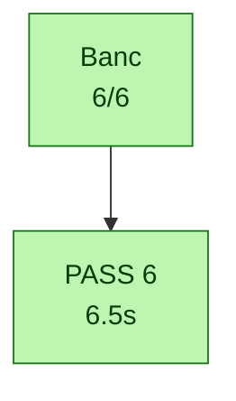

```{r setup, include=FALSE}
knitr::opts_chunk$set(echo = FALSE)
```

# Synthese

**Progression chemin (ponderee, ordonnee) : 7 %**  
FBSB 25% + camping 22% = 47% du but ; total etapes 43 %  
delta FN None - LOST 0 - 20261017_153059

| Etape | Poids | Etat | Description |
|---|---|---|---|
| E0 | 2% | OK | BTS emet SI3/FCCH/SCH |
| P1 | 2% | OK | ipc-device -> FIFO iq_grgsm |
| G1 | 3% | OK | gr-gsm decode SCH (BSIC=7) |
| F1 | 3% | MUR | FN-ALIGN recale FN |
| B1 | 4% | MUR | BSP :6702 feed_iq |
| B3 | 4% | MUR | rx_burst -> DARAM 0x2a00 |
| A0 | 4% | OK | init go-live (ORM/RSBX/IMR) |
| A1 | 4% | MUR | gate 0x0810 bit15 (abort=0) |
| A2 | 4% | OK | IMR=0x52fd, LOST=0 |
| A3 | 5% | MUR | task_md=5 -> 0x8d00 |
| F2 | 6% | MUR | frame-IT vec28 (PRIO) |
| K | 12% | en cours | CORRELATEUR kernel 0xa076 |
| D | 25% | MUR | FBSB / d_fb_det (fb0_ret>0) |
| M | 22% | OK | mobile campe (normal service) |

# Diagrammes temporels

_(pas de donnees log pour les plots temporels)_

# Rapport de tests COMPLET (test_results.md)

```
# Calypso test report a 2026-09-30T00:10:15

> Auto-generated by `tests/conftest.py::pytest_sessionfinish`.
> Pasteable directly in a GitHub issue/PR (Mermaid blocks render natively).

## Status global

> [!TIP]
> a **ALL PASS** a 6/6 (100 %)

| mAtrique | valeur | interprAtation |
|---|---:|---|
| pct brut       | 100 % | `passed / total` (inclut xfail+skip a minore) |
| **pct fonctionnel** | **100 %** | `passed / (passed+failed)` a vrai taux des tests qui prAtendent valider |
| pct actionnable | 100 % | `(passed+failed) / total` a non-xfailed/non-skipped |

| rAsultat | nombre |
|---|---:|
| a passed | 6 |
| a failed | 0 |
| ai  skipped | 0 |
| a i  xfailed | 0 |
| **total** | **6** |


## Variables denvironnement du run

Toutes les variables Calypso/pipeline manipulAes par `run.sh` (extraites du
script + os.environ). `env` = passAe explicitement au lancement ; `default` =
valeur fallback de `run.sh`.

| Variable | Valeur | Source |
|---|---|---|
| `CALYPSO_CONTAINER` | `local` | env |
| `CALYPSO_HOST_ROOT` | `/root` | env |
| `CALYPSO_MOBILE_LOG` | `/tmp/c54x-pont/mobile.log` | env |
| `CALYPSO_MOBILE_VTY` | `4347` | env |
| `CALYPSO_MODE` | `dsp` | env |
| `CALYPSO_MODE_TAG` | `dsp` | env |
| `CALYPSO_MON_SOCK` | `/tmp/qemu-calypso-mon.sock` | env |
| `CALYPSO_OSMOCON_LOG` | `/tmp/c54x-pont/osmocon.log` | env |
| `CALYPSO_QEMU_LOG` | `/tmp/c54x-pont/qemu.log` | env |
| `CALYPSO_SKIP_DIAG_BUNDLE` | `1` | env |
| `CALYPSO_TEST_OUT` | `/root/banc-max-20260930-000727/pytest/reseau` | env |
| `QEMU_TREE` | `/opt/GSM/qosmo` | env |


## Pipeline a oA1 Aa casse

Le pipeline ci-dessous trace le flux logique GSM Calypso, Atape par Atape.
Chaque Atape est colorAe selon le ratio de tests qui passent. **Si une Atape
est rouge (0% pass), cest le premier blocker** a tout ce qui vient aprA s
ne peut pas Aatre validA tant quelle nest pas verte.


a Pipeline complet jusquA  `Mgmt` a pas de rupture dAtectAe dans lordre logique.

## Blockers

_Aucun test en Achec._

## Couches a ce qui marche, ce qui casse

### a `Mgmt` a 6/6
Tous les tests passent dans cette couche.


## Diagramme dAtaillA a un graphe par catAgorie

Chaque catAgorie est rendue dans un graphe sAparA pour lisibilitA (un seul
gros graphe avec subgraphs imbriquAs devient illisible >50 tests). Les
catAgories sont indApendantes cA tA layout a pas de chaAne causale entre
elles dans le dAtail (voir le pipeline plus haut pour Aa).

### a `Banc` a 6/6




## Skipped / xfailed

_Aucun test skipped ou xfailed._

## Catalogue des tests

Liste exhaustive des tests exAcutAs ce run, groupAs par marker pytest.
Source : nodeids pytest + outcome. Pour chaque test, le statut, la durAe
et le fichier source.

### `banc_reseau` a 6/6

| Status | Test | DurAe | Fichier |
|---|---|---:|---|
| a passed | `test_abonne_a_un_msisdn` | 1.30s | `test_40_reseau.py` |
| a passed | `test_abonne_au_vlr` | 1.30s | `test_40_reseau.py` |
| a passed | `test_hlr_connait_l_abonne_avec_cle` | 0.00s | `test_40_reseau.py` |
| a passed | `test_lu_completees_sans_echec` | 1.30s | `test_40_reseau.py` |
| a passed | `test_sccp_utilisateurs_msc_bsc` | 1.30s | `test_40_reseau.py` |
| a passed | `test_stp_asp_msc_et_bsc_actifs` | 1.30s | `test_40_reseau.py` |

### `commun` a 6/6

| Status | Test | DurAe | Fichier |
|---|---|---:|---|
| a passed | `test_abonne_a_un_msisdn` | 1.30s | `test_40_reseau.py` |
| a passed | `test_abonne_au_vlr` | 1.30s | `test_40_reseau.py` |
| a passed | `test_hlr_connait_l_abonne_avec_cle` | 0.00s | `test_40_reseau.py` |
| a passed | `test_lu_completees_sans_echec` | 1.30s | `test_40_reseau.py` |
| a passed | `test_sccp_utilisateurs_msc_bsc` | 1.30s | `test_40_reseau.py` |
| a passed | `test_stp_asp_msc_et_bsc_actifs` | 1.30s | `test_40_reseau.py` |


## Cadence des logs et timers dans le temps

Compte des AvAnements par bucket 10s wall, gAnArA par
`log_timeline.py` sur les logs prAfixAs `<epoch_sec> +<rel_sec>s` par
`run.sh`. Source : `log_timeline.csv` dans ce dossier. Le plot est produit
cA tA RStudio/Quarto via le chunk R ci-dessous (no-op en markdown GitHub a
ouvrir le `.qmd` dans RStudio ou lancer `quarto render` pour le rendu).

```{r log-timeline, fig.cap="Cadence logs (sources) + timers (dA-thinned vs nominal GSM)", fig.width=12, fig.height=9, echo=FALSE, message=FALSE, warning=FALSE}
if (!requireNamespace("ggplot2", quietly=TRUE) ||
    !requireNamespace("tidyr",  quietly=TRUE) ||
    !file.exists("log_timeline.csv")) {
  message("ggplot2/tidyr absent OU log_timeline.csv absent dans le dossier de rendu a plot timeline saute (pas derreur)")
} else {
  library(ggplot2); library(tidyr)
  df <- read.csv("log_timeline.csv")

  # Plot 1 a log volume per source (events/s)
  src_cols <- c("qemu", "bridge", "osmocon", "mobile")
  p1_data <- pivot_longer(df[, c("t_rel", src_cols)], cols=-t_rel,
                          names_to="source", values_to="events")
  p1_data$rate <- p1_data$events / 10
  p1 <- ggplot(p1_data, aes(t_rel, rate, color=source)) +
    geom_line(linewidth=0.6) + scale_y_log10() +
    labs(title="Cadence brute des logs (events/s)",
         x="t_rel (s)", y="events / s (log scale)") +
    theme_minimal()

  # Plot 2 a timer rates dA-thinned vs nominal GSM
  # tdma & frame_irq logguAs 1/1000 ; kick 1/200
  thinning <- c(tdma=1000, frame_irq=1000, kick=200)
  nominal  <- c(tdma=216.7, frame_irq=216.7, kick=200.0)
  tcols <- c("tdma", "frame_irq", "kick")
  p2_data <- pivot_longer(df[, c("t_rel", tcols)], cols=-t_rel,
                          names_to="timer", values_to="events")
  p2_data$rate <- (p2_data$events / 10) *
                  thinning[p2_data$timer]
  nom_df <- data.frame(timer=tcols, nominal=as.numeric(nominal[tcols]))
  p2 <- ggplot(p2_data, aes(t_rel, rate, color=timer)) +
    geom_line(linewidth=0.8) +
    geom_hline(data=nom_df, aes(yintercept=nominal, color=timer),
               linetype="dashed", alpha=0.6) +
    scale_y_log10() +
    labs(title="Timers QEMU : mesurAe (lignes) vs nominale (pointillAs)",
         subtitle="dA-thinned A1000 (tdma/frame_irq) A200 (kick)",
         x="t_rel (s)", y="timer events / s (log scale)") +
    theme_minimal()

  # Plot 3 a DSP signals
  dsp_cols <- c("fb_det_hit", "stack_in_ndb")
  p3_data <- pivot_longer(df[, c("t_rel", dsp_cols)], cols=-t_rel,
                          names_to="signal", values_to="events")
  p3_data$rate <- p3_data$events / 10
  p3 <- ggplot(p3_data, aes(t_rel, rate, color=signal)) +
    geom_line(linewidth=0.6) + scale_y_log10() +
    labs(title="DSP signals (fb-det convergence + stack runaway)",
         x="t_rel (s)", y="events / s (log scale)") +
    theme_minimal()

  # Stack vertical
  if (requireNamespace("patchwork", quietly=TRUE)) {
    library(patchwork); print(p1 / p2 / p3)
  } else {
    print(p1); print(p2); print(p3)
  }
}
```

<details>
<summary>Table brute par bucket 10s a cliquer pour dAplier</summary>

```

```

</details>

## RAsultats bruts pytest

<details>
<summary>Cliquer pour dAplier a sortie verbatim type <code>pytest -v</code></summary>

```
PASSED   test_40_reseau.py::test_abonne_au_vlr (1.302s)
PASSED   test_40_reseau.py::test_abonne_a_un_msisdn (1.301s)
PASSED   test_40_reseau.py::test_hlr_connait_l_abonne_avec_cle (0.003s)
PASSED   test_40_reseau.py::test_lu_completees_sans_echec (1.301s)
PASSED   test_40_reseau.py::test_stp_asp_msc_et_bsc_actifs (1.301s)
PASSED   test_40_reseau.py::test_sccp_utilisateurs_msc_bsc (1.301s)

============================================================
6 passed in 6.51s
```

</details>

## Plan IrDA debug channel (Phase 2)

Statut auto-dAtectA depuis lAtat du run.

| Phase | Objectif | Statut | Action / notes |
|---|---|---|---|
| **Phase 0** | Reconnaissance UART_IRDA mapped + fw driver | a done | QEMU `calypso_soc.c:231-247`, fw `compal_e88/init.c:105` |
| **Phase 0.5** | Smoke test cons_puts boot marker |  A  faire | ajouter `cons_puts("=== fw-irda boot OK ===\r\n")` aprA s `cons_bind_uart(UART_IRDA)` |
| **Phase 1** | QEMU side mapping chardev a UART_IRDA | a i  caduc | dAjA  en place via `-serial pty -serial pty` + `serial_hd(1)` |
| **Phase 2** | Firmware side wrapper IrDA | a i  caduc | dAjA  en place via driver osmocom-bb existant |
| **Phase 3** | Capture host `irda_capture.py` a `/tmp/fw-irda.log` |  lancer le script | `python3 tools/irda_capture.py /dev/pts/3 &` (auto-lancA par run.sh A  terme) |
| **Phase 4** | Tests integration (`test_irda_channel.py`, marker runtime_irda) |  | 8 tests gradAs selon Atat (boot/produces/throughput/...) |
| **Phase 5** | Instrumentation fw `cons_puts(UART_IRDA, ...)` dans hot path |  A  faire | diagnostiquer le mur `task=24 a DATA_IND=0` a events `EVT_TASK24_*` |
| **Phase 6** | Plot Quarto stacked area des events fw |  manuel | extension R chunk dans `log_timeline.csv` parser fw-irda events |

_DAtection auto basAe sur : `/tmp/fw-irda.log` (absent, 0 bytes), `irda_capture.pid` (non), boot marker (absent)._

RAf. `PLAN_CLAUDE_CODE_20260516_IRDA_DEBUG_CHANNEL.md`.

## Chapitre a Blockers dAtaillAs

Pour chaque test en Achec : catAgorie, couche, marker, message dassertion,
audit Python dynamique (greps des keywords du message contre tous les logs
container), et stack trace complet dApliable.

_Aucun test en Achec a pas de chapitre A  gAnArer._


## Annexe a Audit indApendant (`abstract.py`)

Re-compute peer-level produit par `abstract.py` (script racine du repo) A 
partir de `results.json` + `log_timeline.csv` du dossier de run. Ne fait pas
confiance au markdown gAnArA a donne une 2A me lecture indApendante des
mAames donnAes.

<details markdown="1"><summary>DAplier a audit `abstract.py`</summary>

_`abstract.py` introuvable A  la racine du repo._


</details>

## Annexe a Diag snapshot (Atat runtime au moment des tests)

Snapshot rapide produit par `make_diag.sh` au cours de la session pytest.
Pour un bundle complet (tar.gz avec tous les logs filtrAs + dumps DSP), utiliser
`./make_diag_bundle.sh`.

<details markdown="1"><summary>DAplier a diag snapshot</summary>

_diag : `make_diag.sh` introuvable A  la racine du repo._


</details>

## Annexe a Bundle make_diag_bundle.sh

Bundle gAnArA pendant la session via `make_diag_bundle.sh` (inventaire + digests
texte embarquAs). Les logs bruts (qemu_diag, bridge, osmocon, etc.) sont listAs
seulement a rAcupArer le tar.gz pour les contenus complets.

<details markdown="1"><summary>DAplier a bundle make_diag_bundle.sh</summary>

_`make_diag_bundle.sh` introuvable ; ou poser CALYPSO_DIAG_BUNDLE=<tar.gz>._


</details>

## Annexe a DAtail complet de tous les tests

<details markdown="1"><summary>DAplier a table complA te de tous les tests</summary>

### Banc / Mgmt a 6/6

| | Test | Markers | DurAe | Erreur / raison (si non-pass) |
|---|---|---|---:|---|
| a | `test_abonne_a_un_msisdn` | banc_reseau,commun | 1.30s |  |
| a | `test_abonne_au_vlr` | banc_reseau,commun | 1.30s |  |
| a | `test_hlr_connait_l_abonne_avec_cle` | banc_reseau,commun | 0.00s |  |
| a | `test_lu_completees_sans_echec` | banc_reseau,commun | 1.30s |  |
| a | `test_sccp_utilisateurs_msc_bsc` | banc_reseau,commun | 1.30s |  |
| a | `test_stp_asp_msc_et_bsc_actifs` | banc_reseau,commun | 1.30s |  |

### Tous les nodeids (rAfArence)

<details>
<summary>Cliquer pour dAplier a liste exhaustive nodeid a outcome</summary>

```
PASSED   test_40_reseau.py::test_abonne_a_un_msisdn
PASSED   test_40_reseau.py::test_abonne_au_vlr
PASSED   test_40_reseau.py::test_hlr_connait_l_abonne_avec_cle
PASSED   test_40_reseau.py::test_lu_completees_sans_echec
PASSED   test_40_reseau.py::test_sccp_utilisateurs_msc_bsc
PASSED   test_40_reseau.py::test_stp_asp_msc_et_bsc_actifs
```

</details>

</details>

## Reproduction

```bash
cd /home/nirvana/qemu-calypso/tests
/tmp/calypso-venv/bin/pytest -v --tb=short
# Filtrer par marker :
/tmp/calypso-venv/bin/pytest -v -m inject_frames
/tmp/calypso-venv/bin/pytest -v -m not inject_efficacy
```

Le diagramme et ce rapport sont rAgAnArAs A  chaque run et Acrits dans
`/root/banc-max-20260930-000727/pytest/reseau/test_results_20260930_001014/test_results.{mmd,md}` (override via `CALYPSO_TEST_OUT`).

---

_Run finished at 2026-09-30T00:10:15._


## Annexe a Report condensA (machine-friendly)

<details markdown="1"><summary>DAplier a report condensA</summary>

> _Rapport condensA (machine-friendly) extrait de `test_results.md`. Pour la version complA te : voir le `.md` ou `.qmd` A  cA tA._

## Calypso test report a 2026-09-30T00:10:15

> Auto-generated by `tests/conftest.py::pytest_sessionfinish`.
> Pasteable directly in a GitHub issue/PR (Mermaid blocks render natively).

### Status global

> [!TIP]
> a **ALL PASS** a 6/6 (100 %)

| mAtrique | valeur | interprAtation |
|---|---:|---|
| pct brut       | 100 % | `passed / total` (inclut xfail+skip a minore) |
| **pct fonctionnel** | **100 %** | `passed / (passed+failed)` a vrai taux des tests qui prAtendent valider |
| pct actionnable | 100 % | `(passed+failed) / total` a non-xfailed/non-skipped |

| rAsultat | nombre |
|---|---:|
| a passed | 6 |
| a failed | 0 |
| ai  skipped | 0 |
| a i  xfailed | 0 |
| **total** | **6** |


### Variables denvironnement du run

Toutes les variables Calypso/pipeline manipulAes par `run.sh` (extraites du
script + os.environ). `env` = passAe explicitement au lancement ; `default` =
valeur fallback de `run.sh`.

| Variable | Valeur | Source |
|---|---|---|
| `CALYPSO_CONTAINER` | `local` | env |
| `CALYPSO_HOST_ROOT` | `/root` | env |
| `CALYPSO_MOBILE_LOG` | `/tmp/c54x-pont/mobile.log` | env |
| `CALYPSO_MOBILE_VTY` | `4347` | env |
| `CALYPSO_MODE` | `dsp` | env |
| `CALYPSO_MODE_TAG` | `dsp` | env |
| `CALYPSO_MON_SOCK` | `/tmp/qemu-calypso-mon.sock` | env |
| `CALYPSO_OSMOCON_LOG` | `/tmp/c54x-pont/osmocon.log` | env |
| `CALYPSO_QEMU_LOG` | `/tmp/c54x-pont/qemu.log` | env |
| `CALYPSO_SKIP_DIAG_BUNDLE` | `1` | env |
| `CALYPSO_TEST_OUT` | `/root/banc-max-20260930-000727/pytest/reseau` | env |
| `QEMU_TREE` | `/opt/GSM/qosmo` | env |


### Pipeline a oA1 Aa casse

Le pipeline ci-dessous trace le flux logique GSM Calypso, Atape par Atape.
Chaque Atape est colorAe selon le ratio de tests qui passent. **Si une Atape
est rouge (0% pass), cest le premier blocker** a tout ce qui vient aprA s
ne peut pas Aatre validA tant quelle nest pas verte.


a Pipeline complet jusquA  `Mgmt` a pas de rupture dAtectAe dans lordre logique.

### Blockers

_Aucun test en Achec._

### Couches a ce qui marche, ce qui casse

#### a `Mgmt` a 6/6
Tous les tests passent dans cette couche.


### Plan IrDA debug channel (Phase 2)

Statut auto-dAtectA depuis lAtat du run.

| Phase | Objectif | Statut | Action / notes |
|---|---|---|---|
| **Phase 0** | Reconnaissance UART_IRDA mapped + fw driver | a done | QEMU `calypso_soc.c:231-247`, fw `compal_e88/init.c:105` |
| **Phase 0.5** | Smoke test cons_puts boot marker |  A  faire | ajouter `cons_puts("=== fw-irda boot OK ===\r\n")` aprA s `cons_bind_uart(UART_IRDA)` |
| **Phase 1** | QEMU side mapping chardev a UART_IRDA | a i  caduc | dAjA  en place via `-serial pty -serial pty` + `serial_hd(1)` |
| **Phase 2** | Firmware side wrapper IrDA | a i  caduc | dAjA  en place via driver osmocom-bb existant |
| **Phase 3** | Capture host `irda_capture.py` a `/tmp/fw-irda.log` |  lancer le script | `python3 tools/irda_capture.py /dev/pts/3 &` (auto-lancA par run.sh A  terme) |
| **Phase 4** | Tests integration (`test_irda_channel.py`, marker runtime_irda) |  | 8 tests gradAs selon Atat (boot/produces/throughput/...) |
| **Phase 5** | Instrumentation fw `cons_puts(UART_IRDA, ...)` dans hot path |  A  faire | diagnostiquer le mur `task=24 a DATA_IND=0` a events `EVT_TASK24_*` |
| **Phase 6** | Plot Quarto stacked area des events fw |  manuel | extension R chunk dans `log_timeline.csv` parser fw-irda events |

_DAtection auto basAe sur : `/tmp/fw-irda.log` (absent, 0 bytes), `irda_capture.pid` (non), boot marker (absent)._

RAf. `PLAN_CLAUDE_CODE_20260516_IRDA_DEBUG_CHANNEL.md`.

### Chapitre a Blockers dAtaillAs

Pour chaque test en Achec : catAgorie, couche, marker, message dassertion,
audit Python dynamique (greps des keywords du message contre tous les logs
container), et stack trace complet dApliable.

_Aucun test en Achec a pas de chapitre A  gAnArer._


### Annexe a Audit indApendant (`abstract.py`)

Re-compute peer-level produit par `abstract.py` (script racine du repo) A 
partir de `results.json` + `log_timeline.csv` du dossier de run. Ne fait pas
confiance au markdown gAnArA a donne une 2A me lecture indApendante des
mAames donnAes.


### Annexe a Diag snapshot (Atat runtime au moment des tests)

Snapshot rapide produit par `make_diag.sh` au cours de la session pytest.
Pour un bundle complet (tar.gz avec tous les logs filtrAs + dumps DSP), utiliser
`./make_diag_bundle.sh`.


</details>

```
